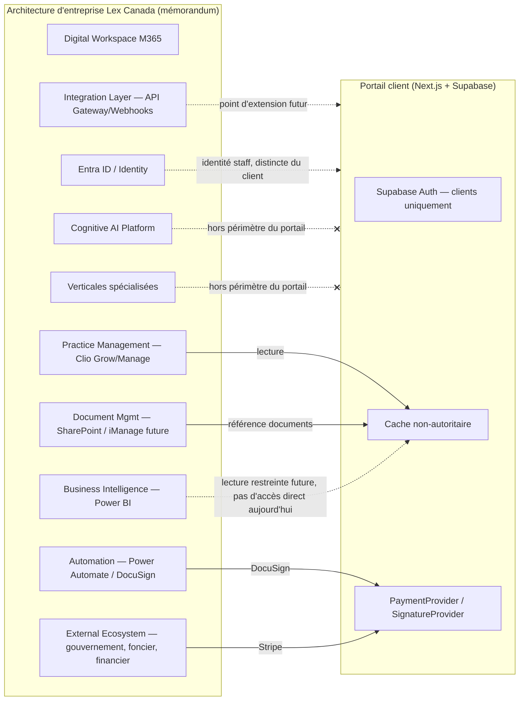

# Alignement — Architecture d'entreprise du cabinet (mémorandum EA) ↔ Architecture du portail client

## 1. Positionnement du portail dans la carte globale

Le portail client est un **sous-système périphérique** de l'architecture d'entreprise Lex Canada Law, pas une réplique. Il se branche sur trois couches déjà prévues par le mémorandum :

## 2. Décisions de clarification apportées suite à cette relecture

| Point | Avant | Après |
|---|---|---|
| Fournisseur documentaire futur | `document_links.provider` limité à `sharepoint`/`clio` | Ajout de `imanage` (non activé, anticipé pour la « Future Phase » du mémorandum) |
| Déclenchement d'automatisations internes | Non prévu | Ajout de `power_automate` dans `integration_provider` (non implémenté, point d'extension documenté) |
| Identité staff (Entra ID) vs identité client (Supabase Auth) | Implicite | Explicité ci-dessous §3 — ce sont deux systèmes distincts, volontairement |
| Stripe comme fournisseur de paiement | Hypothèse parmi d'autres | Confirmé comme faisant déjà partie de l'écosystème financier cible du cabinet (mémorandum EA) — candidat prioritaire pour `PaymentProvider`, à confirmer formellement dans `open-questions.md` |
| Power BI | Non mentionné | Ajouté comme consommateur **futur et restreint** du cache portail — jamais un accès direct à `service_role` ou aux tables brutes |

## 3. Pourquoi deux systèmes d'identité (Entra ID et Supabase Auth) ne sont pas une incohérence

- **Entra ID** gère l'identité des avocats, du personnel et des partenaires — utilisateurs internes déjà équipés M365, MFA, Conditional Access, Intune.
- **Supabase Auth** gère l'identité des **clients externes** du cabinet, qui n'ont et ne doivent pas avoir de compte M365/Entra ID du cabinet.
- Le seul point de jonction prévu (voir `product-requirements.md` §3.3) est une **future fédération SSO pour le personnel interne** accédant à l'espace d'administration du portail — pas pour les clients. Ce point reste une hypothèse d'architecture non implémentée.

## 4. Ce qui reste explicitement hors périmètre du portail (confirmé par cette relecture)

- Cognitive AI Platform (ChatGPT Enterprise, Copilot) — outils internes du cabinet, aucune intégration au portail client.
- Verticales spécialisées (Loom Analytics, DivorceMate, Lexis+/Westlaw, CoCounsel, Spellbook, Teraview, Unity, etc.) — utilisées par le personnel dans Clio/leurs outils métier, jamais appelées directement par le portail.
- Écosystème externe gouvernemental/foncier (IRCC, CRA, FINTRAC, NUANS, registres fonciers) — Clio Manage ou les logiciels verticaux sont les intermédiaires ; le portail n'a et ne doit avoir aucune intégration directe avec ces systèmes.
- Power BI / Business Intelligence — pas de branchement direct au MVP ni aux phases planifiées ; à réévaluer plus tard avec une vue en lecture restreinte si le besoin est confirmé.

## Sources et niveau de confirmation

- Contenu du mémorandum EA fourni par le cabinet (VECTORIEL-PLATEFORME_INFORMATIQUE.pdf) : traité comme recommandation stratégique du cabinet, pas comme contrat technique définitif (le document lui-même le précise : à redessiner avec le partenaire informatique).
- Les modifications de schéma (`imanage`, `power_automate`) sont des anticipations non activées — elles ne changent aucun comportement applicatif tant qu'aucune intégration réelle n'est développée.
- Le statut de Stripe comme candidat renforcé reste à confirmer formellement par le cabinet (voir `docs/open-questions.md` — question paiement).
