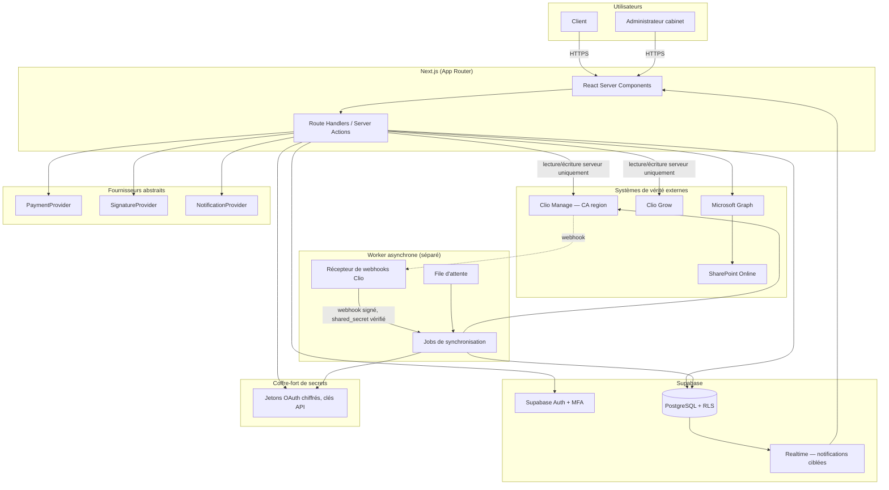

# Architecture cible — Portail Client Lex Canada (Phase 0)

## 1. Explication textuelle

Le portail est un système de **présentation et d'orchestration**, jamais un système de vérité. Trois sources de vérité externes existent déjà (Clio Manage, Clio Grow, SharePoint) ; le portail ajoute une quatrième couche, Supabase, strictement limitée aux données propres au portail (comptes, préférences, droits d'accès, cache non-autoritaire, journaux).

Next.js sert :
- le rendu de l'interface (React Server Components) ;
- des API routes/Server Actions serveur qui sont les **seuls** points de contact autorisés avec Clio et Microsoft Graph — jamais d'appel direct depuis le navigateur.

Un **worker séparé** (fonction planifiée / Azure Function / job Node.js, à trancher en Phase 0 avec le cabinet) gère :
- les synchronisations périodiques (dossiers, factures, calendrier) ;
- la réception et le traitement des webhooks Clio ;
- les traitements longs incompatibles avec les délais d'exécution des fonctions serverless.

## 2. Diagramme d'architecture

## 3. Tableau des responsabilités

| Composant | Responsabilité | Ne doit jamais faire |
|---|---|---|
| Next.js (UI) | Rendu, formulaires, navigation, i18n | Appeler Clio/Graph directement depuis le navigateur |
| Next.js (serveur) | Orchestration, validation, application des règles d'accès avant tout appel externe | Contourner Supabase RLS pour ses propres lectures |
| Supabase Auth | Authentification, MFA, sessions | Être la source de vérité des dossiers ou factures |
| Supabase PostgreSQL + RLS | Comptes, droits, cache non-autoritaire, audit | Stocker les fichiers officiels si SharePoint est confirmé comme dépôt |
| Worker asynchrone | Synchronisations, webhooks, tâches longues | Exposer un accès direct au client |
| Clio Manage | Dossiers, contacts, calendrier, facturation | — (source de vérité) |
| SharePoint / Graph | Documents officiels, versions, rétention | — (source de vérité), sous réserve de confirmation avec le cabinet |
| Coffre-fort de secrets | Jetons OAuth, clés API, rotation | Être accessible au frontend |
| PaymentProvider / SignatureProvider / NotificationProvider | Abstractions d'intégration | Être codées comme si le fournisseur final était déjà choisi |

## 4. Flux de données principaux

1. Client → Next.js UI → Server Action → Supabase RLS (vérification d'accès) → (si autorisé) appel serveur à Clio/Graph → réponse assemblée → UI.
2. Clio (webhook signé) → Worker → validation de signature → mise à jour `matter_cache` / `sync_jobs` → notification Realtime ciblée → UI.
3. Client (upload) → Next.js serveur → antivirus → SharePoint (ou dépôt confirmé) → référence enregistrée dans `document_links` (jamais le contenu du fichier dans Supabase).

## 5. Points de sécurité clés

- Aucun appel Clio/Graph depuis le navigateur ; `service_role` Supabase jamais exposé côté client.
- Jetons OAuth chiffrés au repos, jamais journalisés.
- RLS appliqué sur toutes les tables exposées ; tests de non-régression obligatoires.
- Révocation d'accès immédiate et invalidation de session associée.
- Les URLs de téléchargement de documents sont temporaires et signées.
- Séparation des permissions de lecture et d'écriture sur Microsoft Graph, principe du moindre privilège.

## Sources et niveau de confirmation

| Élément | Statut |
|---|---|
| Régions Clio (`ca.app.clio.com`, `ca.developers.clio.com`) | Confirmé par la documentation |
| OAuth 2.0 Authorization Code + paramètre `state` | Confirmé par la documentation |
| Webhooks Clio Manage signés par `shared_secret`, par modèle de ressource | Confirmé par la documentation |
| Rate limit par défaut 50 req/min, entêtes `X-RateLimit-*` | Confirmé par la documentation |
| Pagination 200 résultats/page | Confirmé par la documentation |
| Région Supabase Canada (`ca-central-1`) | Confirmé par la documentation |
| SharePoint comme dépôt documentaire officiel | Confirmé par le mémorandum EA fourni (VECTORIEL…PDF) — reste une recommandation du cabinet à formaliser, pas encore un contrat technique |
| Nécessité d'un worker séparé | Hypothèse d'architecture — dépend du choix d'hébergement (voir `architecture-evaluation.md`) |
| Modèle d'identité SharePoint (applicative vs déléguée) | À trancher — voir `architecture-evaluation.md` §12 |
