# Diagramme de classes — Portail Client Lex Canada

Ce diagramme couvre (1) les entités du domaine correspondant au schéma Supabase, et (2) les classes de services/intégration (`lib/`, `services/`) prévues par l'architecture. Il complète `data-model.md` (vue ER) avec une vue orientée objet, utile pour la génération de types TypeScript et des services.

```mermaid
classDiagram
  %% ==================== IDENTITÉ ====================
  class Profile {
    +UUID id
    +string email
    +string firstName
    +string lastName
    +string preferredLanguage
    +string phone
    +UserStatus status
    +DateTime createdAt
    +DateTime updatedAt
  }

  class Organization {
    +UUID id
    +string name
    +OrgType type
  }

  class OrganizationMember {
    +UUID organizationId
    +UUID userId
    +MemberRole role
  }

  class ExternalAccount {
    +UUID id
    +UUID userId
    +string provider
    +string externalContactId
    +string externalRegion
    +Json metadata
  }

  %% ==================== DOSSIERS ====================
  class MatterCache {
    +string clioMatterId
    +string displayNumber
    +string title
    +MatterStatus status
    +string practiceArea
    +string responsibleProfessional
    +int progressPercent
    +DateTime lastSyncedAt
    +getTimeline() MatterTimelineStep[]
    +getAccessList() MatterAccess[]
  }

  class MatterTimelineStep {
    +UUID id
    +string matterId
    +string title
    +string description
    +bool isCompleted
    +int position
    +DateTime completedAt
  }

  class MatterAccess {
    +UUID id
    +UUID userId
    +string matterId
    +AccessLevel accessLevel
    +UUID grantedBy
    +DateTime grantedAt
    +DateTime revokedAt
    +isActive() bool
  }

  class AppointmentCache {
    +UUID id
    +string clioCalendarEntryId
    +string matterId
    +string title
    +DateTime startsAt
    +DateTime endsAt
    +string timezone
    +string locationOrLink
  }

  %% ==================== DOCUMENTS ====================
  class DocumentLink {
    +UUID id
    +string matterId
    +string provider
    +string sharepointDriveId
    +string sharepointItemId
    +string clioDocumentId
    +string displayName
    +string category
    +DocumentStatus status
    +string mimeType
    +long sizeBytes
    +getTemporaryDownloadUrl() string
  }

  class DocumentRequest {
    +UUID id
    +string matterId
    +UUID clientId
    +string title
    +string description
    +Date dueDate
    +RequestStatus status
  }

  %% ==================== MESSAGERIE ====================
  class Conversation {
    +UUID id
    +string matterId
    +ConversationScope scope
    +string subject
  }

  class Message {
    +UUID id
    +UUID conversationId
    +UUID senderId
    +string body
    +DateTime createdAt
  }

  class MessageAttachment {
    +UUID id
    +UUID messageId
    +UUID documentId
  }

  %% ==================== FACTURATION ET SIGNATURE ====================
  class InvoiceCache {
    +string id
    +string matterId
    +string invoiceNumber
    +decimal amountTotal
    +decimal balanceDue
    +string currency
    +Date issuedAt
    +Date dueAt
    +string status
  }

  class Payment {
    +UUID id
    +string invoiceId
    +string provider
    +string providerReference
    +decimal amount
    +PaymentStatus status
  }

  class SignatureRequest {
    +UUID id
    +string matterId
    +UUID documentId
    +string provider
    +string providerEnvelopeId
    +SignatureStatus status
    +UUID requestedFor
    +DateTime dueAt
  }

  %% ==================== NOTIFICATIONS / AUDIT ====================
  class Notification {
    +UUID id
    +UUID userId
    +NotificationType type
    +string title
    +string message
    +DateTime readAt
  }

  class AuditEvent {
    +UUID id
    +UUID actorId
    +string action
    +string resourceType
    +string resourceId
    +Json metadata
    +DateTime createdAt
  }

  class SyncJob {
    +UUID id
    +string provider
    +SyncResourceType resourceType
    +string resourceId
    +SyncStatus status
    +int attempts
    +string errorCode
  }

  %% ==================== SERVICES / INTÉGRATIONS (lib/, services/) ====================
  class ClioManageClient {
    -OAuthTokenStore tokenStore
    +getMatters(userExternalId) MatterCache[]
    +getMatter(matterId) MatterCache
    +getBills(matterId) InvoiceCache[]
    +getCalendarEntries(matterId) AppointmentCache[]
    +getDocuments(matterId) DocumentLink[]
    +uploadDocument(matterId, file) DocumentLink
    +handleWebhook(payload, signature) void
  }

  class ClioGrowClient {
    +getContact(contactId) ExternalAccount
  }

  class SharePointClient {
    -GraphCredential credential
    +listDocuments(matterId) DocumentLink[]
    +uploadDocument(matterId, file) DocumentLink
    +getTemporaryDownloadLink(itemId) string
    +subscribeToChanges(driveId) void
  }

  class PaymentProvider {
    <<interface>>
    +createPaymentLink(invoiceId) string
    +getPaymentStatus(paymentId) PaymentStatus
  }
  class StripePaymentProvider {
    +createPaymentLink(invoiceId) string
    +getPaymentStatus(paymentId) PaymentStatus
  }
  class ClioPaymentsProvider {
    +createPaymentLink(invoiceId) string
    +getPaymentStatus(paymentId) PaymentStatus
  }
  class MockPaymentProvider {
    +createPaymentLink(invoiceId) string
    +getPaymentStatus(paymentId) PaymentStatus
  }
  PaymentProvider <|.. StripePaymentProvider
  PaymentProvider <|.. ClioPaymentsProvider
  PaymentProvider <|.. MockPaymentProvider

  class SignatureProvider {
    <<interface>>
    +createSignatureRequest(documentId, signerId) SignatureRequest
    +getStatus(envelopeId) SignatureStatus
  }
  class DocuSignProvider {
    +createSignatureRequest(documentId, signerId) SignatureRequest
    +getStatus(envelopeId) SignatureStatus
  }
  SignatureProvider <|.. DocuSignProvider

  class NotificationProvider {
    <<interface>>
    +send(userId, notification) void
  }
  class EmailNotificationProvider {
    +send(userId, notification) void
  }
  class InAppNotificationProvider {
    +send(userId, notification) void
  }
  NotificationProvider <|.. EmailNotificationProvider
  NotificationProvider <|.. InAppNotificationProvider

  class AccessControlService {
    +canAccessMatter(userId, matterId) bool
    +grantAccess(userId, matterId, grantedBy) MatterAccess
    +revokeAccess(matterId, userId) void
  }

  class AuditService {
    +record(actorId, action, resourceType, resourceId, metadata) AuditEvent
  }

  %% ==================== RELATIONS ====================
  Profile "1" --> "many" OrganizationMember
  Organization "1" --> "many" OrganizationMember
  Profile "1" --> "many" ExternalAccount
  Profile "1" --> "many" MatterAccess
  MatterCache "1" --> "many" MatterAccess
  MatterCache "1" --> "many" MatterTimelineStep
  MatterCache "1" --> "many" AppointmentCache
  MatterCache "1" --> "many" DocumentLink
  MatterCache "1" --> "many" DocumentRequest
  MatterCache "1" --> "many" Conversation
  MatterCache "1" --> "many" InvoiceCache
  MatterCache "1" --> "many" SignatureRequest
  Conversation "1" --> "many" Message
  Message "1" --> "many" MessageAttachment
  MessageAttachment "many" --> "1" DocumentLink
  InvoiceCache "1" --> "many" Payment
  Profile "1" --> "many" Notification
  Profile "1" --> "many" AuditEvent

  AccessControlService ..> MatterAccess : gère
  ClioManageClient ..> MatterCache : alimente (cache)
  ClioManageClient ..> InvoiceCache : alimente (cache)
  ClioManageClient ..> AppointmentCache : alimente (cache)
  SharePointClient ..> DocumentLink : alimente (référence)
  ClioManageClient ..> SyncJob : produit
  SharePointClient ..> SyncJob : produit
```

## Notes de conception

- Les classes `PaymentProvider`, `SignatureProvider`, `NotificationProvider` sont des **interfaces** (`<<interface>>`) — obligatoire pour respecter la règle « ne jamais coder une intégration comme si elle fonctionnait avant confirmation ». Tant qu'un fournisseur n'est pas confirmé, seule `MockPaymentProvider` est instanciée, et c'est documenté explicitement dans le code (commentaire + entrée dans `open-questions.md`).
- `ClioManageClient` et `SharePointClient` ne sont **jamais** instanciés côté navigateur — uniquement dans `lib/clio/`, `lib/sharepoint/`, appelés depuis des Route Handlers/Server Actions.
- `AccessControlService.canAccessMatter` doit être appelé **avant** tout appel à `ClioManageClient`/`SharePointClient` sur un `matterId` donné — jamais après.

## Sources et niveau de confirmation

Ce diagramme est une conception dérivée du schéma SQL (`supabase/schema.sql`) et du cahier des charges. Les interfaces de services reflètent les règles de développement déjà actées dans `product-requirements.md` §12. Aucune de ces classes n'est encore implémentée.
