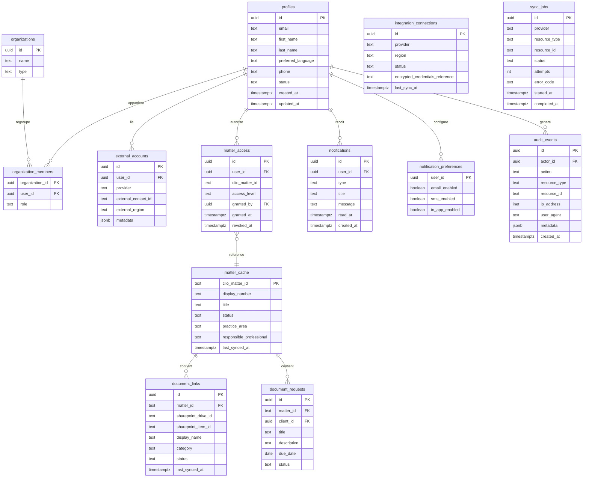

# Modèle de données Supabase — Phase 0 (conception, pas de migration exécutée)

Ce document décrit le modèle relationnel prévu. Aucune migration n'est créée en Phase 0 (voir `docs/decisions/` pour l'ADR correspondant).

## 1. Tables

## 2. Notes de conception

- `matter_cache.clio_matter_id` et `document_links.matter_id` référencent l'identifiant Clio, pas un identifiant Supabase natif — le dossier n'existe « en propre » que dans Clio.
- `external_accounts` permet de supporter plusieurs fournisseurs externes futurs (Clio, potentiellement Entra ID pour le personnel) sans dupliquer `profiles`.
- `integration_connections.encrypted_credentials_reference` est une **référence** vers un coffre-fort de secrets externe — jamais le secret lui-même en base.
- Aucune donnée bancaire, aucun contenu de document, aucun jeton OAuth en clair dans ce modèle.

## 3. Ce qui n'est délibérément pas stocké dans Supabase

- Le contenu des documents (référence uniquement).
- Les montants détaillés de facturation au-delà de ce qui est nécessaire à l'affichage (le solde peut être caché à l'affichage seul, sans devenir une table de vérité comptable).
- Les jetons OAuth en clair.
- Les informations bancaires du client.

## Sources et niveau de confirmation

- Structure des tables : reprise et affinée à partir du cahier des charges fourni.
- Aucune contrainte technique Supabase spécifique (types, limites de colonnes) n'a été vérifiée dans cette phase au-delà de la disponibilité générale de PostgreSQL et RLS — **hypothèse d'architecture**, à valider techniquement en Phase 1 lors de l'écriture réelle des migrations.
