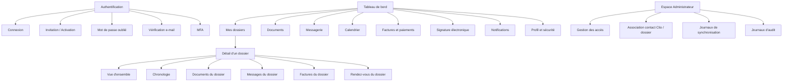

# Cartographie des pages — Portail Client Lex Canada

> **Limite importante :** la maquette (`https://lexcanada-jdkordhm.manus.space/`) est une application monopage dont le contenu n'a pas pu être extrait par récupération automatisée (seules les métadonnées Open Graph ont été retournées). Cette cartographie est donc construite à partir du cahier des charges fourni, **pas** d'une inspection confirmée de la maquette. Une revue visuelle manuelle est requise avant la Phase 1 pour valider l'alignement.

## 1. Arborescence des pages

## 2. Tableau des pages

| Page | Rôle(s) | Données affichées | Source principale | Statut de faisabilité |
|---|---|---|---|---|
| Connexion / Invitation / MFA | Client, Admin | Identité, session | Supabase Auth | Confirmé |
| Tableau de bord | Client | Résumé multi-dossiers, échéances, actions | Supabase (cache) + Clio | Hypothèse d'architecture (agrégation applicative) |
| Mes dossiers | Client | Liste filtrable des dossiers autorisés | `matter_access` (Supabase) + `matters` (Clio) | Partiellement disponible |
| Détail d'un dossier | Client | Vue d'ensemble, chronologie, sous-onglets | Clio (matter, activities) + Supabase (statut portail) | Partiellement disponible — la « chronologie orientée client » n'existe pas nativement dans Clio, elle doit être construite (à valider quelle donnée Clio l'alimente : activités ? notes ? champ personnalisé ?) |
| Documents | Client | Liste, statuts de demande, dépôt/téléchargement | SharePoint (officiel, selon mémorandum EA) ou Clio Documents | À valider avec le cabinet — deux sources possibles, une seule doit être retenue |
| Messagerie | Client | Conversations par dossier | À déterminer | À valider avec Clio — voir `sharepoint-integration.md` n/a, voir section messagerie de `clio-api-mapping.md` |
| Calendrier | Client | Rendez-vous, échéances | Clio Calendar/Activities | Confirmé par la documentation |
| Factures et paiements | Client | Factures, soldes, historique, paiement | Clio Bills + Clio Payments ou Stripe (abstraction `PaymentProvider`) | Partiellement disponible |
| Signature électronique | Client | Statuts de signature | DocuSign (hypothèse) | Hypothèse d'architecture — aucun produit de signature Clio confirmé |
| Notifications | Client | Notifications in-app, préférences | Supabase (propre au portail) | Hypothèse d'architecture |
| Profil et sécurité | Client | Infos personnelles, MFA, sessions | Supabase Auth + `profiles` | Confirmé |
| Espace Administrateur | Admin | Accès, associations, synchronisations, audit | Supabase | Hypothèse d'architecture |

## Sources et niveau de confirmation

- Cahier des charges fourni par le cabinet (source primaire de cette cartographie).
- Maquette : **non inspectée avec succès** — à revoir manuellement.
- Aucune capacité Clio n'est supposée ici sans renvoi vers `clio-api-mapping.md`.
