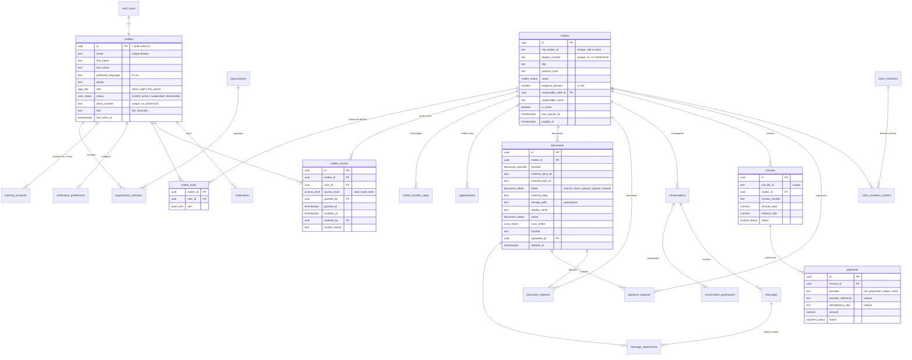
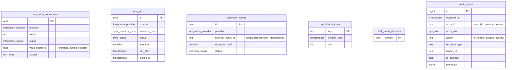

# Architecture de la base de données Supabase — v2.0

> Remplace `docs/archive/data-model-v1.md`. Le SQL de référence, exécutable, est `supabase/schema.sql`.
> Il est validé sur PostgreSQL 16 par les 32 scénarios de `supabase/tests/rls-scenarios.sql` (2026-10-01).
> Les écarts par rapport à la v1 sont listés dans `docs/decisions/0003-schema-v2.md`.

## 1. Principes

1. **Supabase n'est jamais la source de vérité** d'une donnée qui existe dans Clio ou SharePoint. Les tables de cache portent `last_synced_at`, et l'interface affiche la fraîcheur des données.
2. **Trois schémas, deux non exposés :**

| Schéma | Exposé à l'API (PostgREST) | Contenu |
|---|---|---|
| `public` | Oui. RLS sur **toutes** les tables | Données affichées dans le portail |
| `private` | **Non** | Fonctions d'aide RLS, connexions d'intégration, files de synchronisation, webhooks, limitation de débit |
| `audit` | **Non** | Journal append-only (`audit.events`) |

3. **Les droits sont vérifiés à chaque requête.** Une révocation dans `matter_access` coupe l'accès **immédiatement** : dossiers, documents, messages, factures et notifications. Il n'est pas nécessaire d'attendre l'expiration du jeton (≈ 1 h).
4. **MFA dans la base.** Un client ne lit aucun dossier sans session `aal2` (claim `aal` du JWT Supabase). Le personnel passe par Entra ID, où le MFA est imposé par l'accès conditionnel Microsoft.
5. **Défense en profondeur.** RLS, privilèges par table et par colonne (`GRANT`) et triggers de garde se cumulent. Ces trois couches s'ajoutent à la vérification serveur (`AccessControlService`).
6. **Aucun secret en base** : jetons OAuth dans Supabase Vault ou Azure Key Vault (référence `vault_secret_id`), aucune donnée de carte, aucun contenu de document.

## 2. Rôles

| Rôle (`profiles.role`) | Comment on l'obtient | Périmètre |
|---|---|---|
| `client` | Invitation par un firm_admin, puis activation | Dossiers listés dans `matter_access` (non révoqués), avec MFA |
| `staff` | Connexion Microsoft Entra ID (`provider = azure`) **et** domaine dans `private.staff_email_domains` | Dossiers où il figure dans `matter_team` |
| `firm_admin` | **Jamais automatique.** Promotion manuelle par le serveur (service_role), journalisée | Tout le portail, gestion des accès, audit |

Un compte Entra ID hors domaine est créé `client` / `suspended`, sans aucun accès (scénario T26).
Le rôle, le statut et l'e-mail ne peuvent être modifiés que par le serveur (scénario T12).

## 3. Diagramme entité-relation

Schémas non exposés :

## 4. Dictionnaire des tables

### 4.1 `public` (22 tables)

| Domaine | Table | Rôle | Source de vérité | Écrit par |
|---|---|---|---|---|
| Identité | `profiles` | Profil 1:1 avec `auth.users` | Supabase | Trigger + client (colonnes perso) + serveur |
| | `organizations` | Client personne morale | Supabase (`clio_contact_id`) | firm_admin |
| | `organization_members` | Contacts d'une entreprise cliente | Supabase | firm_admin |
| | `external_accounts` | Lien vers le contact Clio ou l'objet Entra ID | Supabase | Serveur |
| Dossiers | `matters` | Registre + cache d'affichage Clio, **jamais supprimé** | **Clio** | Synchronisation / firm_admin |
| | `matter_team` | Personnel affecté | Supabase (dérivé de Clio) | firm_admin |
| | `matter_access` | **Table centrale de sécurité** : accès client | Supabase | firm_admin (octroi / révocation) |
| | `matter_timeline_steps` | Chronologie orientée client | Supabase | Équipe du dossier |
| Calendrier | `appointments` | Rendez-vous | **Clio** Calendar | Synchronisation / équipe |
| Documents | `documents` | Références SharePoint (+ quarantaine) ; visibilité déduite de `folder` | **SharePoint** (ADR 0004) | Synchronisation Graph / serveur (dépôt client) |
| | `document_requests` | Pièces demandées au client | Supabase | Équipe |
| Messagerie | `conversations` | Fil par dossier ou général | Supabase | Équipe ; client `read_write` |
| | `conversation_participants` | Participants + `last_read_at` | Supabase | Équipe ; client (`last_read_at`) |
| | `messages` | Messages (sans modification ni suppression) | Supabase | Participants |
| | `message_attachments` | Pièces jointes, qui sont des `documents` | Supabase | Serveur |
| Facturation | `invoices` | Factures et soldes | **Clio** Bills | Synchronisation |
| | `payments` | Transactions (PaymentProvider) | **Fournisseur de paiement** | Serveur (webhook) |
| Signature | `signature_requests` | Enveloppes (SignatureProvider) | **DocuSign** | Équipe / serveur |
| Notifications | `notifications` | Notifications in-app | Supabase | Serveur |
| | `notification_preferences` | Préférences e-mail/SMS/in-app | Supabase | Utilisateur |
| Invitations | `client_invitations` | Invitation (jeton haché SHA-256, 72 h) | Supabase | firm_admin ; acceptation par le serveur |
| | `client_invitation_matters` | Dossiers attribués à l'activation | Supabase | firm_admin |

### 4.2 `private` et `audit`

| Table | Rôle |
|---|---|
| `private.staff_email_domains` | Domaines du personnel (`lexcanadalaw.com`) |
| `private.integration_connections` | Connexion par fournisseur et région ; secret dans le coffre-fort (`vault_secret_id`) |
| `private.sync_jobs` | File de synchronisation (verrou `locked_at`, `run_after`, `max_attempts`, état `dead`) |
| `private.matter_storage_folders` | Dossier SharePoint de chaque matter (site, lecteur, 3 sous-dossiers client, URL pour le personnel) |
| `private.graph_delta_state` | Jeton delta Graph par bibliothèque (synchronisation incrémentale) |
| `private.graph_subscriptions` | Abonnements de notification Graph, hachage du `clientState`, expiration |
| `private.webhook_events` | Idempotence (`unique(provider, external_event_id)`) et preuve de vérification de signature |
| `private.rate_limit_buckets` | Compteurs anti-force brute (connexion, téléversement, invitations) |
| `audit.events` | Journal **append-only** : UPDATE, DELETE et TRUNCATE sont bloqués par trigger, même pour le propriétaire (T30) |

### 4.3 Sessions (J3.2, ADR 0012)
- `private.session_activity` (`session_id`, `user_id`, `created_at`, `last_seen_at`) : activité par session, inaccessible par l'API.
- `public.touch_session()` (`authenticated`) : `active` ou `expired` (inactivité > 32 min, ou session de plus de 12 h). Sans paramètre : tout est lu dans le JWT.
- `public.revoke_user_sessions(uuid)` (`service_role`) : supprime les sessions Auth (jetons de rafraîchissement en cascade) et l'activité d'un compte.

### 4.4 Intégrations (Phase 2, ADR 0014)
- `private.integration_connections` : référence `vault_secret_id`, jamais de jeton.
- RPC `integration_save_tokens`, `integration_read_tokens`, `integration_report` et `integration_disconnect` : service_role seulement, jetons dans **Supabase Vault**.
- `integration_status_list()` : firm_admin, état sans jeton.
- Messagerie (revue, ADR 0014) : colonnes insérables limitées ; `private.force_server_timestamps` impose les dates pour une session utilisateur.

### 4.5 Messagerie du cabinet (J7, ADR 0017)
- `public.matter_permissions(uuid)` (`authenticated`, security invoker) : `can_read` et `can_write` effectifs pour la session.
- `public.join_conversation(uuid)` (`authenticated`, security definer) : seuls l'équipe du dossier et le firm_admin s'inscrivent comme participants.
- `conversations` : `id` insérable (l'application génère l'identifiant, voir le bogue #49).

## 5. Matrice d'accès RLS

> **Mise à jour J2.1 (ADR 0009)** : « C » suppose désormais un compte **actif + MFA** pour toutes les tables, y compris la messagerie générale et les notifications. « S » suppose une connexion **Microsoft** (ou `aal2`). Le personnel ne voit les participants, organisations et clients que des dossiers **actifs de son équipe**. Les colonnes internes (motifs et auteurs de révocation, identifiants SharePoint et Clio) ne sont plus lisibles par l'API utilisateur ; RPC `list_matter_access()` pour le firm_admin et l'équipe.

Abréviations : **C** = client (accès actif + MFA), **S** = staff de l'équipe du dossier, **A** = firm_admin, **Srv** = serveur (service_role, contourne RLS).

| Table | SELECT | INSERT | UPDATE | DELETE |
|---|---|---|---|---|
| `profiles` | Soi ; S : personnel + clients de ses dossiers ; C : personnel de ses dossiers ; A : tous | Trigger | Soi : nom, téléphone, langue. Rôle et statut : Srv | — |
| `matters` | C, S, A | A, Srv | S, A, Srv | **Jamais** |
| `matter_team` | C, S, A | A | — | A |
| `matter_access` | Soi, S, A | A (clients uniquement) | A : **révocation seulement**, définitive | **Jamais** |
| `matter_timeline_steps`, `appointments` | C, S, A | S, A | S, A | — |
| `documents` | S, A : tout. C : `folder` ≠ `internal` **et** sain **et** non supprimé | S, A, Srv | S, A | — (suppression logique) |
| `document_requests` | S, A ; C : celles qui lui sont adressées | S, A | S, A | — |
| `conversations` | Participant **et** dossier lisible ; S du dossier | C `read_write`, S (créateur = soi) | S | — |
| `messages` | Participant **et** dossier lisible | Participant, `sender_id = soi`, dossier en écriture, fil ouvert | — | — |
| `invoices` | C, S, A | Srv | Srv | — |
| `payments` | S, A ; C : ses paiements | Srv | Srv | — |
| `signature_requests` | S, A ; C : les siennes | S, A | S, A | — |
| `notifications` | Soi (et dossier encore lisible) | Srv | Soi : `read_at` | — |
| `client_invitations*` | A | A | A | A |
| `private.*`, `audit.*` | **Aucun accès** (lecture de l'audit par A via `list_audit_events()`) | Srv / triggers | Srv | — |

**RPC exposées :** `list_audit_events(limit, before, matter_id)` (firm_admin) et `client_dashboard_counts()`, qui alimente les 4 cartes du tableau de bord (security invoker, donc filtrée par RLS).

## 6. Stockage des fichiers (Phase 3) — SharePoint, voir `sharepoint-integration.md`

Le dépôt officiel est **SharePoint** (ADR 0004). Supabase ne garde que des références. Le bucket ci-dessous ne sert que si l'antivirus retenu est l'**option A**.

- Bucket **`quarantine`**, privé, sans politique de lecture pour `authenticated`. Le client dépose via une **URL d'envoi signée** émise par le serveur, après contrôle de `can_write_matter`.
- Chemin : `quarantine/{matter_id}/{document_id}/{nom-assaini}`.
- Pipeline : contrôle MIME réel (magic bytes) + taille → antivirus → `scan_status = clean` → envoi dans `02 Déposé par le client` (SharePoint) → `storage_path` vidé, objet de quarantaine supprimé.
- Téléchargement : le serveur transmet le contenu SharePoint **en flux** après `assertMatterAccess`, puis `audit.record('document.downloaded', …)`. Aucune URL SharePoint n'est envoyée au client.

## 7. Cycle de vie et rétention

| Donnée | Règle |
|---|---|
| Dossier clos | `status = closed`. Après le délai fixé par le cabinet : purge des champs descriptifs (`title` = numéro, `description` = null, etc.) et `purged_at` renseigné. La ligne reste pour l'audit. |
| Cache Clio (`appointments`, `invoices`) | Écrasé à chaque synchronisation ; supprimable après la clôture du dossier |
| Accès client | Jamais supprimé : révoqué (`revoked_at`, `revoked_by`, `revoke_reason`) |
| Audit | Conservation longue, durée à fixer avec le conseiller en conformité (open-questions) |
| Compte client | `deactivated` plutôt que suppression ; l'effacement passe par une procédure documentée |

## 8. Événements journalisés automatiquement (triggers)

`profile.role_status_changed` · `matter_team.added` / `.removed` · `matter_access.granted` / `.revoked` · `invitation.created` / `.accepted` / `.expired` / `.revoked`.

Le serveur journalise en plus, via `audit.record()` : `auth.login`, `auth.mfa_enrolled`, `auth.logout_all`, `matter.viewed`, `document.downloaded`, `document.uploaded`, `invoice.viewed`, `payment.initiated`, `signature.requested`, `integration.connected`.

## 9. Mise en œuvre (Phase 1) — **fait en J2 (ADR 0007)**

> État au 2026-10-01 : les migrations `supabase/migrations/20261001120000_initial_schema.sql` (= schéma v2.1) et `…120100_harden_default_privileges.sql` **font foi** ; `supabase/schema.sql` est figé. Commandes : `pnpm db:start · db:reset · db:test · db:types · db:seed-passwords`.

1. `supabase init`, puis `supabase/schema.sql` → première migration `supabase/migrations/<horodatage>_initial_schema.sql`.
2. `supabase db reset` doit passer sans erreur.
3. Convertir `supabase/tests/rls-scenarios.sql` en tests **pgTAP** (`supabase test db`), bloquants en CI.
4. Générer les types : `supabase gen types typescript --local > types/database.ts`.
5. Données fictives : `supabase/seed.sql` d'après `docs/mock-data.md` (`is_mock = true`).
6. Créer le premier firm_admin manuellement, puis l'inscrire dans un ADR :
   `update public.profiles set role = 'firm_admin' where email = '<admin>@lexcanadalaw.com';` (avec service_role).
7. Dans Supabase Auth : **désactiver les inscriptions publiques**, activer le MFA TOTP, configurer le fournisseur Azure avec l'URL du tenant (single-tenant).

## Suivi du dossier (ADR 0018, migration `20261007120000_matter_tracking.sql`)
- `matter_timeline_steps` : suppression ouverte à l'équipe du dossier et au firm_admin (`timeline_staff_delete`).
- `matters.progress_percent` : calculé par le trigger `matter_timeline_progress` (part des étapes terminées, NULL sans étape).
- Audit des étapes par le trigger `matter_timeline_audit` (identifiants seulement).
- `public.move_timeline_step(p_step uuid, p_direction integer)` : security invoker, `EXECUTE` pour `authenticated` seulement.

## Modèles de dossiers (ADR 0019, migrations `20261007130000` et `20261007130100`)
- `matter_types`, `matter_type_steps`, `matter_type_documents`, `matter_type_fields` : lecture par le personnel, écriture par le firm_admin. Les libellés des champs visibles sont lisibles par le client d'un dossier de ce type.
- `matters.matter_type_id` (lisible par l'API ; choisi par l'équipe).
- `matter_field_values` (matter_id, field_id, value ≤ 500) : écriture par l'équipe ou le firm_admin ; lecture client limitée aux champs visibles ; trigger « champ du même type ».
- `matter_timeline_steps.title_en`, `description_en` ; `document_requests.title_en`, `description_en`.
- `document_requests` : triggers `document_requests_guard` (destinataire avec accès actif ; auteur, statut et date imposés) et `document_requests_audit`.

## Espace « Dossier » (ADR 0020, migrations `20261008120000` et `20261008120100`)
- `matter_deliverables` (titre, description, date prévue, état `planned` / `in_progress` / `delivered` / `cancelled`, responsable du personnel, `visible_to_client`, `delivered_at`) :
  - RLS : écriture par l'équipe du dossier ou le firm_admin ; lecture client limitée aux livrables visibles d'un dossier lisible ;
  - trigger `matter_deliverables_guard` : responsable du personnel, dossier et auteur figés, date de remise posée par la base ;
  - audit `matter_deliverable.*`, identifiants seulement.
- `document_requests.fulfilled_document_id` : trigger `document_requests_document` (création et modification).
  - Aucun document lié à la création.
  - Ensuite, seulement un document **du même dossier et non interne**, et la demande passe à « reçue ».
  - Il s'exécute avant `document_requests_guard`.

## Étiquettes (ADR 0021, migration `20261008130000`)
- `matter_tags` : lecture par le personnel, écriture par le firm_admin ; le client lit les étiquettes visibles posées sur ses dossiers (`private.client_sees_tag`).
- `matter_tag_links` (matter_id, tag_id) : pose et retrait par l'équipe ou le firm_admin ; le client ne lit que les liens d'étiquettes visibles (`private.tag_is_visible`). Auteur imposé, audit `matter_tag.*`.

## Vues enregistrées (ADR 0023, migration `20261009120000_saved_views.sql`)
- `matter_saved_views` (owner_id, name, query) : filtres du portefeuille enregistrés sous un nom, **personnels**. RLS : lecture, création et suppression par le seul propriétaire, s'il fait partie du personnel. Le propriétaire est imposé par défaut (`auth.uid()`). La requête est limitée à 500 caractères du jeu d'URL, et le serveur la remet sous forme canonique. Au plus 20 vues par personne : limite vérifiée par le service et garantie par le trigger `private.guard_saved_views_limit` (migration `20261009120100`).

## Bureaux et tribunaux (ADR 0024, migration `20261015120000_offices_courts.sql`)
- `offices` (nom FR/EN, ville, province, fuseau, adresse, `is_active`) et `courts` (nom FR/EN, compétence province ou `FED`, fuseau) : lecture par le personnel, création et modification par le firm_admin, **aucune suppression** (archivage).
- `staff_offices` (user_id, office_id, is_primary) : un seul bureau principal par personne (index unique partiel). Personnel actif seulement, bureau actif seulement (trigger `private.guard_staff_office`). Écriture par `public.set_staff_offices(p_user, p_primary, p_others)` : firm_admin, une seule transaction (migration `20261015120100`).
- `matters.office_id` : bureau du dossier, modifiable par l'équipe ou le firm_admin (politique existante). Bureau actif obligatoire, à la création comme à la modification (`private.guard_matter_office`). Changement journalisé (`matter.office_set`).
- Le bureau **ne donne aucun droit** sur les dossiers.

## Dates de cour (ADR 0025, migrations `20261016130000` et `20261016130100`)
- `court_dates` : une date de cour par ligne, avec le fuseau du tribunal, le statut (`scheduled` = à confirmer, `confirmed`, `adjourned`, `cancelled`, `held`), la confirmation (imposée par `private.guard_court_date`), la date remplacée (`replaces_id`) et l'état de l'écriture dans Clio (`clio_sync_status`, `clio_calendar_entry_id`). RLS : équipe du dossier ou firm_admin, en lecture, création et modification, avec des **droits par colonne** : la confirmation et la synchronisation Clio sont écrites par la base et le serveur seulement. **Aucune suppression** (annulation avec motif). Client : aucun accès.
- `court_date_attendees` : membres du personnel actifs présents à une date.
- `private.integration_connections.settings` : calendrier Clio des dates de cour (`court_calendar_id`). **Aucun secret ne doit jamais y être rangé** : les jetons restent dans le coffre-fort. Écriture par `public.set_clio_court_calendar` (firm_admin) ; lecture par `public.clio_court_calendar()` (personnel) et par `public.clio_court_calendar_internal()` (service_role, synchronisation).

## Dates de cour côté client (ADR 0028, migration `20261017130000`)
- `public.client_court_dates(p_matter)` : lecture client des dates rendues visibles, en colonnes limitées (sans notes, juge, greffe, présents ni état Clio). Session client avec double vérification et accès actif exigés.
- `private.court_date_reminders` (court_date_id, user_id, kind '7d' ou '1d') : rappels déjà envoyés. Réservation par `public.claim_court_date_reminder`, réservée à service_role.
- Type de notification `court_date_reminder`.
## Calendrier de cour : adjoint·e·s (ADR 0027, migration `20261017120000`)
- `court_calendar_viewers` (user_id) : personnel désigné par le firm_admin pour voir toutes les dates de cour du cabinet. Lecture par le personnel, écriture par le firm_admin, journalisée.
- `public.court_calendar_feed(p_from, p_to)` : lecture du calendrier en colonnes limitées (sans notes, lien virtuel, consignes, juge ni greffe ; titre du dossier réservé à l'équipe), sur 62 jours au plus et 500 lignes au plus. Elle couvre l'équipe du dossier, le firm_admin et les personnes désignées. La RLS de `court_dates` est inchangée.

## Contrats (ADR 0032, migration `20261020120000`)
- `contracts` : titre, langue, statut (`draft`, `in_review` ; `validated`, `sent`, `signed`, `declined` au lot 3 ; `cancelled` avec motif ; `superseded`), dossier lié facultatif, client existant facultatif (`client_id`, un vrai client visible de la personne) et **copie** des coordonnées du client (nom, courriel, adresse, téléphone, langue), auteur imposé, verrou (`locked_by`, `locked_until`), `is_mock`. RLS : personnel actif auteur, équipe du dossier lié, firm_admin. Droits par colonne : verrou, auteur et démonstration jamais écrits par l'utilisateur. Aucune suppression.
- `contract_sections` : position, titre, contenu JSON ProseMirror (`jsonb`, 200 ko au plus, liste blanche vérifiée par le serveur), `ai_assisted`. Écriture : seulement en tenant le verrou, en brouillon ou en relecture (`private.can_edit_contract`).
- `contract_versions` : copies complètes (en-tête et sections). Écrites par `public.contract_save_version` et `public.contract_restore_version` (verrou exigé ; la version courante est enregistrée avant un retour en arrière).
- Fonctions : `contract_acquire_lock`, `contract_release_lock`, `contract_client_email_known` (personnel ; oui ou non).
- Journal (trigger) : `contract.created`, `contract.<statut>`, `contract.matter_linked` ; par les fonctions : `contract.version_saved`, `contract.version_restored` ; par le serveur : `contract.ai_assisted`.

