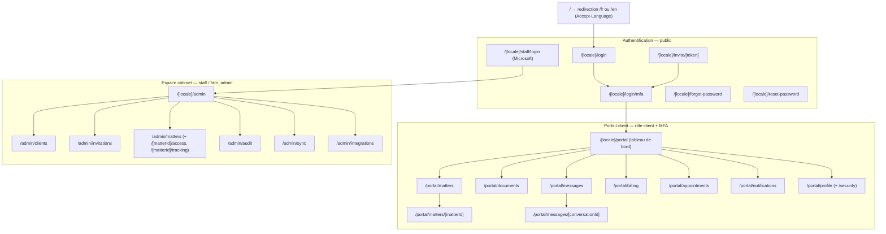

# Cartographie des pages — Portail Client Lex Canada (v2)

> v2 du 2026-10-01. La **maquette a été inspectée** (https://lexcanada-jdkordhm.manus.space/portal : écran de connexion et code des écrans du portail), ce qui lève la limite signalée dans `archive/page-map-v1.md`.
> Design détaillé : `docs/design-system.md` · Données fictives : `docs/mock-data.md`.

## 1. Arborescence

## 2. Pages

| Route | Rôle | Contenu | Source de données | Phase |
|---|---|---|---|---|
| `/[locale]/login` | Public | Écran partagé de la maquette, e-mail + mot de passe | Supabase Auth | 1 |
| `/[locale]/login/mfa` | Client connecté en `aal1` | Saisie TOTP ; enrôlement obligatoire à la 1re connexion | Supabase Auth MFA | 1 |
| `/[locale]/login/mfa/lost` | Public | Marche à suivre si l'application d'authentification est perdue (aucune réinitialisation en ligne, ADR 0012) | — | 1 |
| `/[locale]/admin/messages` | staff, firm_admin | Fils des dossiers de l'équipe, non-lus, nouveau message (ADR 0017) | Supabase (RLS) | 1 |
| `/[locale]/admin/messages/[conversationId]` | staff, firm_admin | Lire, répondre, clore (rejoindre le fil à l'ouverture) | Supabase (RLS) | 1 |
| `/[locale]/admin/security/mfa-reset` | firm_admin | Réinitialisation de la MFA d'un client après vérification d'identité (`docs/runbooks/mfa-reset.md`) | Supabase Auth (admin) | 1 |
| `/[locale]/forgot-password`, `/reset-password` | Public | Réinitialisation. Message neutre (« si un compte existe… ») : pas d'énumération des comptes | Supabase Auth | 1 |
| `/[locale]/invite/[token]` | Public, jeton valide | Activation : vérification du jeton, création du mot de passe, puis enrôlement MFA | `client_invitations` (serveur) | 1 |
| `/[locale]/staff/login` | Personnel | Bouton « Se connecter avec Microsoft » (tenant LEXCANADALAW.COM) | Entra ID via Supabase Auth | 1 |
| `/[locale]/portal` | Client | Bandeau action requise, 4 indicateurs, dossiers récents, messages récents | `client_dashboard_counts()`, `matters`, `messages`, `signature_requests` | 1 (mock) |
| `/portal/matters` | Client | Cartes dossier (numéro, titre, domaine, statut, progression, responsable), filtres | `matters` | 1 mock → 2 Clio |
| `/portal/matters/[matterId]` | Client | Onglets : Vue d'ensemble · Chronologie · Documents · Messages · Factures · Rendez-vous | `matters`, `matter_timeline_steps`, … | 1 mock → 2 |
| `/portal/documents` | Client | Onglets **Partagés par le cabinet / Mes dépôts / Signés** (= sous-dossiers SharePoint), filtre par dossier, pièces demandées, aperçu, téléchargement, signature, dépôt | `documents` (réf. **SharePoint**), `document_requests`, `signature_requests` | 1 mock → 3 |
| `/portal/messages` | Client | Fils par dossier, envoi si `read_write` | `conversations`, `messages` | 1 mock → 4 |
| `/portal/billing` | Client | Factures, soldes, statut, bouton Payer (désactivé tant que le fournisseur est mock) | `invoices`, `payments` | 1 mock → 2 lecture → 4 paiement |
| `/portal/appointments` | Client | Rendez-vous à venir et passés, fuseau America/Halifax, ajout au calendrier (.ics) | `appointments` | 1 mock → 2 |
| `/portal/search?q=` | Client | Résultats de la recherche globale de l'en-tête (« Search files, messages... »), groupés : dossiers, documents, messages ; limités par la RLS | `matters`, `documents`, `messages` | 1 |
| `/portal/notifications` | Client | Liste urgent / info / success, marquer comme lu, préférences | `notifications`, `notification_preferences` | 1 |
| `/portal/profile` | Client | Identité, langue, téléphone ; **Sécurité** : MFA, changement de mot de passe, « déconnecter tous les appareils » | `profiles`, Supabase Auth | 1 |
| `/[locale]/admin` | Staff, firm_admin | Vue d'ensemble : invitations en attente, erreurs de synchronisation, derniers événements | Plusieurs | 1 |
| `/admin/clients` | firm_admin (staff en lecture : ses clients) | Liste, statut, suspension, dossiers associés | `profiles`, `matter_access` | 1 |
| `/admin/invitations` | firm_admin | Créer une invitation (contact Clio + dossiers + niveau d'accès), renvoyer, révoquer | `client_invitations*` | 1 |
| `/admin/matters` (filtres : recherche, étiquette, type, avocat, statut, alerte — ADR 0021 ; affichage **liste ou tableau par étape** et **vues enregistrées** — ADR 0023), `/[matterId]/access` | firm_admin (staff : ses dossiers) | Équipe, accès clients, **révocation immédiate**, chronologie, documents, **lien « Ouvrir dans SharePoint »** (personnel seulement), état du dossier SharePoint | `matters`, `matter_team`, `matter_access` | 1 |
| `/admin/matters/[matterId]` (onglets) | équipe du dossier, firm_admin | **Espace Dossier** (ADR 0020) : vue d'ensemble, étapes et livrables, documents, équipe et accès, informations. `/tracking` et `/access` y redirigent. | `matters`, `matter_timeline_steps`, `matter_deliverables`, `document_requests`, `matter_team`, `matter_access` | 1 |
| `/admin/matters/new` | firm_admin | **Assistant d'ouverture** d'un dossier venu de Clio | idem | 1 |
| `/admin` | personnel | Accueil de l'espace cabinet, avec le panneau **« À surveiller »** : demandes et livrables en retard ou dus dans les 7 jours, dossiers inactifs depuis 14 jours (ADR 0023) | `document_requests`, `matter_deliverables`, `matters` | 1 |
| `/admin/requests`, `/admin/requests/new` | personnel | **Demandes de documents** sur tous les dossiers : filtres, actions groupées (relancer, reçu, annuler), envoi groupé à plusieurs dossiers (ADR 0022) | `document_requests`, `matter_access`, `matter_tag_links` | 1 |
| `/admin/matters/[matterId]/tracking` | équipe du dossier, firm_admin | **Suivi du dossier** (ADR 0018, 0019 : type, étapes du modèle, informations du dossier, **documents demandés au client**) : étapes visibles par le client (ajouter, terminer, réordonner, modifier, supprimer), avancement calculé, **équipe du dossier** (ajout et retrait : firm_admin) | `matter_timeline_steps`, `matter_team` | 1 |
| `/admin/templates`, `/[typeId]` | firm_admin | **Modèles de dossiers** (ADR 0019) : types de dossier par groupe de pratique, étapes types, documents à demander, informations du dossier (champs visibles ou internes), bilingues | `matter_types`, `matter_type_steps`, `matter_type_documents`, `matter_type_fields` | 1 |
| `/admin/audit` | firm_admin | Journal filtrable (dossier, acteur, action, période), export CSV | `list_audit_events()` | 1 |
| `/admin/sync` | firm_admin | État des jobs, erreurs, relance manuelle, fraîcheur par ressource | `private.sync_jobs` (via serveur) | 2 |
| `/admin/integrations` | firm_admin | Connexion Clio (OAuth), Graph, fournisseurs (affiche uniquement le statut et les scopes, jamais de secret) | `private.integration_connections` (via serveur) | 2 |

## 3. Écarts volontaires par rapport à la maquette

| Maquette | Décision | Raison |
|---|---|---|
| Onglet « Integrations » visible par le client | Déplacé dans `/admin/integrations` | Information interne au cabinet, inutile et non pertinente pour un client |
| « Protected by 256-bit SSL encryption » | « Connexion chiffrée (TLS) · Authentification à deux facteurs » | Formulation exacte et vérifiable |
| Aucune étape MFA | Écran `/login/mfa` obligatoire | `security.md` : MFA obligatoire pour les clients |
| Aucun accès personnel | `/staff/login` (Microsoft) + `/admin` | Exigence Entra ID |
| Interface 100 % anglaise | FR/EN complet, FR par défaut (à confirmer) | `product-requirements.md` §4 |
| Pas de rendez-vous ni de profil | Pages ajoutées | `mvp-scope.md` (calendrier et profil sont dans le MVP) |
| Données en dur | Fixtures `is_mock = true` + badge « Données de démonstration » | Ne jamais présenter des données fictives comme réelles |

## 4. Comportements transversaux

- **Garde d'accès** : le middleware redirige `/portal/*` vers login (sans session) ou vers MFA (si `aal1`). Le layout serveur revérifie le rôle (`requireRole`). La RLS fait la vérification finale.
- **Identifiant inconnu ou interdit** : la même page 404 dans les deux cas. On ne distingue jamais « n'existe pas » de « pas autorisé ».
- **Fraîcheur** : toute donnée issue de Clio affiche `FreshnessIndicator` (« Mis à jour il y a X min »). Au-delà de 24 h, avertissement « Données possiblement périmées ».
- **États** : chaque page prévoit un état de chargement (squelettes), un état vide (message et action utile) et un état d'erreur (message neutre, sans détail technique).
- **Expiration de session** : retour au login avec un message, puis redirection vers la page demandée.
