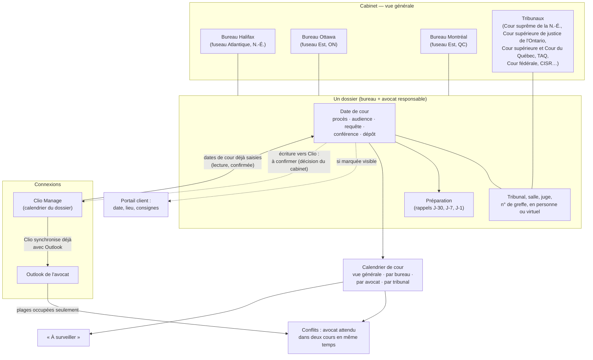

# Plan de travail — Bureaux et calendrier de cour

> Brouillon, à relire et valider avant tout développement.
> Rédigé le 2026-10-09, puis révisé après précision du responsable : il s'agit des **procès et audiences au tribunal**, pas des processus internes.
> Ce plan avance une partie de la phase 7 de `docs/plan-developpement.md`.

## 1. Ce que j'ai compris

Dans la gestion de projet (l'espace cabinet), il faut :

1. **Créer et gérer des bureaux** (par exemple Halifax, Ottawa et Montréal), et y rattacher les avocats et les dossiers.
2. **Un calendrier de cour** : les procès, audiences, requêtes, conférences de gestion, comparutions et dates de dépôt devant les tribunaux.
   - Une **vue par bureau**.
   - Une **vue générale** de tout le cabinet.
3. **Une option pour connecter les calendriers** (Outlook, Microsoft 365, et le calendrier de Clio) : une date de cour saisie une seule fois apparaît partout, sans doublon.

## 2. Carte d'ensemble

## 3. Angles morts relevés, et ce que je propose

| # | Angle mort | Risque | Proposition |
|---|---|---|---|
| 1 | **Une seule source de vérité** : les dates de cour sont peut-être déjà saisies dans Clio, et Clio synchronise déjà avec Outlook. | Saisir la même audience dans Clio et dans la plateforme donne des doublons ou des dates divergentes, ce qui est grave pour un procès. | La **source reste Clio** (règle du projet). La plateforme lit le calendrier Clio, qui est une ressource confirmée, et y reconnaît les dates de cour. Créer ou modifier une date depuis la plateforme demande **l'écriture vers Clio**, à confirmer (section 5). Avant cela, la saisie se fait dans Clio. |
| 2 | **Délais légaux** (prescription, délais de signification et de dépôt selon les règles de procédure de la N.-É. et de l'Ontario) | Une date calculée automatiquement et fausse peut faire perdre un droit au client. | La plateforme **ne calcule jamais seule un délai légal**. Elle peut proposer un rappel, mais **l'avocat confirme chaque date**, et chaque confirmation est journalisée (qui, quand). |
| 3 | **Fuseaux horaires** (Halifax : Atlantique ; Ottawa : Est) | Une audience à 9 h 30 à Toronto vue depuis Halifax. | L'heure s'affiche **dans le fuseau du tribunal**, avec la conversion pour l'utilisateur si elle diffère. Les changements d'heure sont gérés. |
| 4 | **Conflits d'horaire** : un avocat attendu dans deux cours en même temps, ou sans temps de déplacement. | Absence en cour. | Alerte de conflit, avec une marge de déplacement réglable. Elle apparaît dans « À surveiller » et sur la fiche de l'avocat. |
| 5 | **Remises et ajournements** | Une audience déplacée laisse l'ancienne date dans les agendas. | Statuts : prévue, confirmée, remise (avec la nouvelle date liée), annulée, tenue. L'historique est conservé. Une date remise n'apparaît plus comme active, et l'agenda est mis à jour. |
| 6 | **Audiences virtuelles** (Teams, Zoom, liens de la cour) | Un lien de connexion est sensible. | Le lien est réservé à l'équipe du dossier. Il est envoyé au client seulement si l'avocat le décide, et jamais dans un e-mail : seulement dans le portail. |
| 7 | **Le client** | Le client doit savoir quand et où se présenter, mais pas tout voir. | Une date de cour peut être marquée « visible par le client ». Il voit alors la date, l'heure, le lieu ou le lien, et les **consignes** rédigées par l'avocat (pièces à apporter, tenue, arrivée 30 min avant). Il reçoit un rappel dans le portail. Les notes internes restent cachées. |
| 8 | **Tribunaux et salles** | Des noms tapés de dix façons différentes rendent les filtres inutiles. | Une **liste des tribunaux** gérée par l'administrateur : nom FR/EN, province, adresse, fuseau. Le personnel choisit dans la liste. |
| 9 | **Jours fériés et fermetures des tribunaux** (provinciaux, fédéraux, vacances judiciaires) | Une date proposée un jour de fermeture. | Les jours fériés par province sont signalés dans le calendrier. Une date un jour férié n'est pas bloquée, mais un avertissement s'affiche. |
| 10 | **Bureau et droits d'accès** | Si le bureau ouvre l'accès aux dossiers, c'est un changement de sécurité important. | Par défaut, le bureau **ne donne aucun droit** : l'accès reste celui de l'équipe du dossier. La **vue générale** est pour l'administrateur ; le personnel voit les dossiers de ses équipes, dans tous les bureaux. Un rôle « responsable de bureau » est une décision à prendre (section 5). |
| 11 | **Supprimer un bureau ou un tribunal** | Des dossiers et des audiences y sont rattachés. | On **archive**, on ne supprime pas. |
| 12 | **Connexion Outlook** (jetons, départ d'un employé) | Un jeton qui traîne. | Les jetons sont gardés dans le coffre-fort (Supabase Vault, déjà décidé). On peut déconnecter son agenda, et un administrateur peut couper une connexion. Une personne désactivée est déconnectée automatiquement. Tout est journalisé. On lit **seulement les plages occupées**, jamais le contenu de l'agenda. |
| 13 | **Doublons dans Outlook** | Clio envoie déjà ses rendez-vous dans Outlook. | La plateforme **n'écrit pas** les dates de cour dans Outlook : elles y arrivent déjà par Clio. Elle n'y envoie que ses **rappels de préparation**, dans un agenda séparé « Lex Portail », si l'avocat le souhaite. |
| 14 | **Téléphone et accessibilité** | Une grille mensuelle illisible sur un écran de 375 px. | Sur téléphone, **vue liste par jour** par défaut. Au clavier et au lecteur d'écran, chaque date se lit en texte (date, heure, tribunal, dossier). |
| 15 | **Environnement de test** | Pas d'enregistrement Microsoft (Azure), et le Clio de test est vide. | Simulateur pour Outlook. Dates de cour fictives (badge « démonstration ») et compte Clio de test pour la lecture. |
| 16 | **Obligations déontologiques** (Barreau) | Un oubli de date de cour est une faute courante en responsabilité professionnelle. | **Double rappel** (plateforme et Outlook), et une liste « audiences des 14 prochains jours » sur l'accueil. Une date ne peut être retirée que par l'équipe du dossier, avec un motif journalisé. |

### Conséquences du bureau de Montréal (ajout du 2026-10-15)

| # | Point | Proposition |
|---|---|---|
| 17 | **Loi 25 (Québec)** : renseignements personnels des clients du bureau de Montréal | Le cabinet désigne un responsable de la protection des renseignements personnels. Une **évaluation des facteurs relatifs à la vie privée** est faite avant tout transfert hors Québec (OpenAI notamment). Les incidents sont consignés dans un registre. Je ne tranche pas : c'est une décision du cabinet (`docs/open-questions.md`). |
| 18 | **Tribunaux du Québec** : procédure civile du Québec, audiences et actes surtout en français | Liste des tribunaux du Québec dans les données de départ. Consignes au client dans la langue de son choix. Aucun calcul de délai, comme partout ailleurs. |
| 19 | **Jours fériés du Québec** (Saint-Jean-Baptiste, Journée nationale des patriotes…) | Jours fériés par province : N.-É., Ontario et Québec, plus les jours fériés fédéraux pour la Cour fédérale. |

## 4. Plan de travail

Je découpe le travail en lots livrables séparément. Chaque lot suit le flux habituel : QA, revue de sécurité, demande de fusion, serveur de test, puis « Comment tester ».

| Lot | Contenu | Accès externe nécessaire | Base de données |
|---|---|---|---|
| **1. Bureaux et tribunaux** | Créer, modifier et archiver les **bureaux** (nom, province, fuseau, adresse) et les **tribunaux** (nom FR/EN, province, adresse, fuseau). Rattacher les avocats (bureau principal et autres bureaux) et les dossiers. Filtre « bureau » dans le portefeuille, le tableau, les demandes et « À surveiller ». | Aucun | Bureaux, tribunaux, personnes par bureau, bureau du dossier, RLS et tests |
| **2. Dates de cour** | Dans un dossier, un onglet « Cour » qui regroupe ses dates de cour : • sorte : procès, audience, requête, conférence de gestion, comparution, date limite de dépôt ; • tribunal, salle, juge, n° de greffe ; • en personne ou virtuel ; • statut ; avocats présents ; • notes internes et consignes pour le client. **Confirmation par l'avocat**, remises liées, historique, et visibilité client facultative. Lecture des dates déjà saisies dans Clio. | Clio de test pour la lecture. **Écriture vers Clio** si le cabinet l'autorise. | Dates de cour, historique, RLS et tests |
| **3. Calendrier de cour** | Page « Calendrier de cour » : • **vue générale** du cabinet et **vue par bureau**, en mois, semaine ou liste ; • filtres : bureau, avocat, tribunal, sorte, statut, « mes dossiers » ; • **conflits d'horaire** signalés ; • « Audiences des 14 prochains jours » sur l'accueil ; • rappels de préparation à J-30, J-7 et J-1 ; • liste par jour sur téléphone. | Aucun | Aucune, ou presque : préférences de rappel |
| **4. Connexion des agendas** | **Outlook** : connecter ou déconnecter son agenda, lire les plages occupées (pour les conflits), envoyer les rappels de préparation dans l'agenda « Lex Portail ». **Clio** : synchronisation régulière des dates de cour. Vue administrateur des connexions. D'abord avec le **simulateur**. | **Oui** : enregistrement Azure (permissions d'agenda, consentement de l'administrateur Microsoft 365) | Connexions d'agenda, correspondance entre dates et événements, audit |
| **5. Côté client** | Dans le portail : prochaines dates de cour visibles, consignes, rappel dans le portail (et par e-mail **sans détail**, quand les vrais e-mails seront branchés). | Aucun | Aucune |
| **6. Charge par bureau** (plus tard) | Audiences et dossiers par avocat, par bureau et par tribunal. | Aucun | Aucune |

**Ordre proposé** :
- Lots 1, 2, 3 et 5 d'abord : démontrables tout de suite, avec des données fictives et le Clio de test.
- Lot 4 avec le simulateur ensuite, branché pour de vrai dès que l'accès Azure est fourni.

## 5. Décisions à prendre par le cabinet

Ces points ne sont pas techniques : je ne les tranche pas moi-même.

1. ~~Liste des bureaux~~ : **Ottawa, Halifax, Montréal** (décidé le 2026-10-15). Reste à fournir : l'adresse de chaque bureau et le bureau principal de chaque avocat.
2. **Liste des tribunaux** fréquentés, par bureau. Je peux proposer une liste de départ (N.-É., Ontario, fédéral, CISR) à valider.
3. **Où saisit-on une date de cour** : dans Clio, et la plateforme la lit (aucun risque de doublon) ; ou aussi dans la plateforme, qui l'écrit dans Clio, à condition que le cabinet autorise l'écriture vers Clio. Ma recommandation : **commencer par la lecture depuis Clio, plus la saisie dans la plateforme de ce que Clio n'a pas** (tribunal, salle, consignes client, confirmation par l'avocat). Ensuite, ajouter l'écriture vers Clio si elle est autorisée.
4. **Le bureau donne-t-il des droits ?** Par exemple, un « responsable de bureau » verrait toutes les audiences de son bureau. Ma recommandation : **pas pour l'instant**. La vue générale est réservée à l'administrateur.
5. **Rappels** : délais (J-30, J-7, J-1 proposés), et qui les reçoit : l'avocat, l'adjointe, l'équipe ?
6. **Le client** doit-il voir ses dates de cour par défaut, ou seulement quand l'avocat les rend visibles ? Ma recommandation : **seulement sur décision de l'avocat**.
7. **Outlook** : le consentement de l'administrateur Microsoft 365 du cabinet sera nécessaire pour le lot 4.

## 6. User stories (zone E — Bureaux et calendrier de cour)

Les rôles sont ceux de `docs/user-stories.md` : **Personnel** (membre du cabinet), **Admin** (firm_admin), **Client**. Après votre validation, chaque story deviendra une issue GitHub.

### Lot 1 — Bureaux et tribunaux

**E1. En tant qu'Admin, je veux créer et gérer les bureaux du cabinet, afin d'organiser les dossiers et les audiences par lieu.**
- [ ] Je crée un bureau avec un nom FR/EN, une ville, une province et un fuseau horaire (liste fermée). L'adresse est facultative.
- [ ] Je modifie un bureau ; je l'archive, je ne le supprime pas. Ses dossiers et son historique restent.
- [ ] Deux bureaux ne peuvent pas avoir le même nom.
- [ ] Le Personnel voit la liste mais ne la modifie pas : il reçoit la réponse « introuvable ». Le Client ne voit aucun bureau.
- [ ] La création, la modification et l'archivage sont journalisés.
- *Tests* : pgTAP (droits par rôle), e2e sur ordinateur et à 375 px, avec axe.

**E2. En tant qu'Admin, je veux gérer la liste des tribunaux, afin que chacun choisisse le bon tribunal sans fautes de frappe.**
- [ ] Un tribunal a un nom FR/EN, une province, une adresse et un fuseau. On peut l'archiver.
- [ ] Une liste de départ (N.-É., Ontario, fédéral, CISR) est proposée en données de démonstration, à valider par le cabinet.
- [ ] Les changements sont journalisés. Le Personnel lit la liste, le Client ne la voit pas.

**E3. En tant qu'Admin, je veux rattacher chaque avocat à un bureau principal, et éventuellement à d'autres, afin de filtrer le calendrier par bureau.**
- [ ] Bureau principal, plus d'autres bureaux. Un bureau archivé ne peut pas être choisi.
- [ ] Le changement est journalisé.
- [ ] Il ne donne **aucun accès** supplémentaire aux dossiers : un test le prouve.

**E4. En tant que Personnel, je veux qu'un dossier soit rattaché à un bureau, et pouvoir filtrer par bureau, afin de ne voir que ce qui concerne mon bureau.**
- [ ] Dans l'assistant d'ouverture, le bureau est proposé par défaut (celui de l'avocat responsable) et peut être changé. Le changement est journalisé.
- [ ] Le filtre « Bureau » existe dans le portefeuille, le tableau, les demandes, « À surveiller » et le calendrier de cour, et peut être enregistré dans une vue.
- [ ] Le filtre ne montre jamais un dossier hors de mes équipes : un test le prouve.

### Lot 2 — Dates de cour

**E5. En tant que Personnel, je veux inscrire une date de cour dans un dossier, afin que l'équipe sache où et quand se présenter.**
- [ ] Champs :
  - sorte (procès, audience, requête, conférence de gestion, comparution, date limite de dépôt) ;
  - date et heure de début et de fin, ou journée entière ;
  - tribunal (liste), salle, juge (facultatif), n° de greffe ;
  - en personne ou virtuel (lien réservé à l'équipe) ;
  - avocats présents ;
  - notes internes.
- [ ] L'heure est saisie et affichée **dans le fuseau du tribunal**.
- [ ] Seule l'équipe du dossier, ou l'Admin, peut créer ou modifier une date. Un dossier d'une autre équipe donne la réponse « introuvable ».
- [ ] La création, la modification et la suppression sont journalisées, sans contenu des notes.

**E6. En tant qu'Avocat, je veux confirmer chaque date de cour, afin qu'aucune date non vérifiée ne soit prise pour acquise.**
- [ ] Une date saisie est « à confirmer » tant qu'un avocat de l'équipe ne l'a pas confirmée.
- [ ] La confirmation est journalisée (qui, quand) et affichée.
- [ ] Les dates non confirmées apparaissent dans « À surveiller ».
- [ ] La plateforme **ne calcule aucun délai légal** : c'est écrit à l'écran.

**E7. En tant que Personnel, je veux remettre ou annuler une date de cour sans perdre l'historique, afin de suivre les ajournements.**
- [ ] Statuts : prévue, confirmée, remise, annulée, tenue.
- [ ] « Remettre » crée la nouvelle date, liée à l'ancienne, et demande une nouvelle confirmation.
- [ ] L'historique des dates du dossier est visible par l'équipe.
- [ ] Retirer une date exige un motif, et ce retrait est journalisé.

**E8. En tant que Personnel, je veux voir dans un dossier les dates de cour déjà saisies dans Clio, afin de ne pas les ressaisir.**
- [ ] Les rendez-vous Clio du dossier reconnus comme dates de cour sont affichés avec la mention « Clio » et la date de la dernière synchronisation.
- [ ] Je peux les compléter (tribunal, salle, consignes, confirmation) sans changer l'original dans Clio, tant que l'écriture vers Clio n'est pas autorisée.
- [ ] Un champ masqué par Clio est traité comme absent.

### Lot 3 — Calendrier de cour

**E9. En tant qu'Admin, je veux une vue générale du calendrier de cour de tout le cabinet, afin de voir toutes les audiences, tous bureaux confondus.**
- [ ] Vues mois, semaine et liste. Navigation précédent, aujourd'hui, suivant. La période se retrouve dans l'adresse de la page.
- [ ] Chaque date montre : heure (fuseau du tribunal), sorte, tribunal, dossier, avocats, statut. Les dates non confirmées sont signalées.
- [ ] Un clic ouvre le dossier sur l'onglet « Cour ».

**E10. En tant que Personnel, je veux le calendrier de cour de mon bureau et le mien, afin de préparer mes audiences.**
- [ ] Filtres : bureau, avocat, tribunal, sorte, statut, « mes dossiers seulement ». Ils peuvent être enregistrés comme une vue.
- [ ] Je ne vois que les dossiers de mes équipes (tous pour l'Admin). Un test le prouve.

**E11. En tant qu'Avocat, je veux être averti d'un conflit d'horaire, afin de ne jamais être attendu dans deux cours en même temps.**
- [ ] Deux dates du même avocat qui se chevauchent, ou qui laissent moins que la marge de déplacement (réglable), sont signalées en rouge.
- [ ] Le conflit apparaît dans « À surveiller » et sur les deux dates concernées.
- [ ] Si mon Outlook est connecté (lot 4), mes plages occupées comptent aussi.

**E12. En tant que Personnel, je veux des rappels avant chaque date de cour, afin de préparer à temps.**
- [ ] Les rappels arrivent à J-30, J-7 et J-1 (réglables par le cabinet), dans la plateforme, pour les avocats présents et l'équipe.
- [ ] Une liste « Audiences des 14 prochains jours » s'affiche sur l'accueil de l'espace cabinet.
- [ ] Il n'y a pas de rappel pour une date annulée ou remise.

**E13. En tant que Personnel sur téléphone, je veux un calendrier lisible, afin de vérifier une audience en déplacement.**
- [ ] À 375 px, la liste par jour s'affiche par défaut, sans défilement horizontal de la page.
- [ ] Toute la page s'utilise au clavier, et chaque date est lisible par un lecteur d'écran.
- [ ] axe sans violation grave, en FR et en EN.
- [ ] Les changements d'heure (mars et novembre) et les fuseaux (Atlantique, Est) sont testés.

### Lot 4 — Connexion des agendas

**E14. En tant que Personnel, je veux connecter mon agenda Outlook, afin que mes conflits et mes rappels tiennent compte de mon agenda réel.**
- [ ] Le bouton « Connecter mon agenda Outlook » ouvre la connexion Microsoft du cabinet. Les permissions demandées sont limitées à l'agenda.
- [ ] La plateforme lit **seulement les plages occupées**, jamais le titre ni les participants.
- [ ] Si je le souhaite, mes rappels de préparation sont envoyés dans un agenda séparé « Lex Portail ». Les dates de cour elles-mêmes n'y sont pas recopiées, puisque Clio les synchronise déjà : il n'y a donc pas de doublon.
- [ ] L'état est affiché : connecté, dernière synchronisation, ou « à reconnecter ». La connexion est journalisée. Le jeton est gardé dans le coffre-fort et n'apparaît jamais dans un log.
- *Tests* : avec le simulateur ; le test réel attend l'accès Azure.

**E15. En tant que Personnel, je veux déconnecter mon agenda, et en tant qu'Admin couper la connexion d'une personne, afin de garder le contrôle.**
- [ ] « Déconnecter » supprime le jeton et arrête la synchronisation.
- [ ] L'Admin voit la liste des connexions (personne, état, dernière synchronisation) et peut en couper une.
- [ ] Un membre du personnel désactivé est déconnecté automatiquement.
- [ ] Chaque déconnexion est journalisée.

**E16. En tant que Personnel, je veux que les dates de cour de Clio arrivent seules dans la plateforme, afin que le calendrier de cour soit toujours à jour.**
- [ ] Une synchronisation régulière lit le calendrier Clio : les nouvelles dates apparaissent, les dates modifiées sont mises à jour, les dates supprimées passent au statut « annulée » (avec historique).
- [ ] Une date modifiée dans Clio après sa confirmation redevient « à confirmer ».
- [ ] En cas d'échec, une nouvelle tentative est faite automatiquement, et une alerte apparaît dans « À surveiller ».

### Lot 5 — Côté client

**E17. En tant que Client, je veux voir mes prochaines dates de cour et les consignes de mon avocat, afin d'être présent et préparé.**
- [ ] Je vois seulement les dates que l'avocat a rendues visibles : date, heure (avec le fuseau), lieu ou lien, consignes.
- [ ] Je ne vois jamais les notes internes, les autres avocats présents, le juge si l'avocat ne l'a pas rendu visible, ni les conflits.
- [ ] Je reçois un rappel dans le portail à J-7 et J-1. L'e-mail ne contient aucun détail, seulement « vous avez une date à venir, connectez-vous ».
- [ ] Une date d'un autre client donne la réponse « introuvable ». Un test pgTAP et un test e2e le prouvent.

### Lot 6 — Plus tard

**E18. En tant qu'Admin, je veux voir la charge d'audiences par avocat, par bureau et par tribunal, afin de répartir les dossiers.** Le détail sera écrit après les lots 1 à 5.

## 7. Ce que je vous demande

1. Validez ou corrigez ce plan : la compréhension, les lots, l'ordre.
2. Répondez aux décisions de la section 5. Le point 3 (où saisit-on une date de cour) est le plus important.
3. Après votre accord :
   - je publie les stories E1 à E18 en issues GitHub ;
   - je commence le **lot 1 (Bureaux et tribunaux)**.
