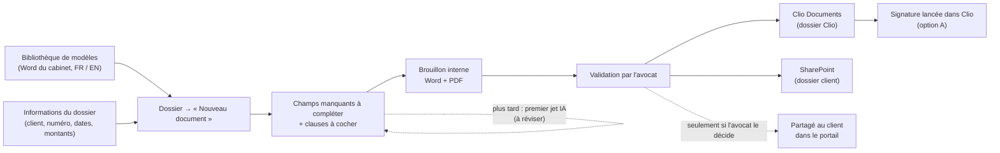

# Plan — Contrats : modèles prédéfinis, génération dans le dossier, dépôt Clio et SharePoint, assistant IA

> Statut : **proposition, en attente de validation** (2026-10-18). Aucun code n'est écrit avant votre « oui ».
> Rattachement au plan général : phase 4 « Ressources et rédaction » et phase 6 « Assistant de rédaction (IA) » de `docs/plan-developpement.md`.

## 1. Ce que j'ai compris

1. **Des contrats prédéfinis** : le cabinet garde ses modèles (contrats, lettres de mandat, conventions d'honoraires…) dans une bibliothèque, en français et en anglais, classés par domaine (Immigration, Légal, Affaires).
2. **Générer un contrat depuis un dossier** : on choisit un modèle, les informations du dossier se remplissent seules, l'avocat complète et relit, puis la plateforme produit le document en Word et en PDF.
3. **Le ranger dans Clio ET dans SharePoint** (décision du 2026-10-18).
4. **Plus tard, l'IA (OpenAI)** propose un premier jet, une révision ou une traduction. L'avocat valide toujours.

## 2. Comment ça marche, en une image

## 3. Angles morts relevés, et ce que je propose

| # | Angle mort | Risque | Ce que je propose |
|---|---|---|---|
| 1 | **Les avocats travaillent dans Word** | Un éditeur maison ne remplacera pas Word ; il serait long à construire et mal aimé. | Les modèles **restent des fichiers Word** du cabinet, avec des champs du type `{{client.nom}}`. La plateforme les remplit et produit un **Word modifiable** et un **PDF**. L'avocat peaufine dans Word s'il le souhaite, puis redépose la version finale. |
| 2 | **Champ manquant ou faux** (adresse absente dans Clio, nom mal orthographié) | Un contrat avec un blanc ou une erreur part chez le client. | Chaque champ vide est **demandé avant la génération** et surligné dans l'aperçu. Rien ne part sans la validation explicite de l'avocat. |
| 3 | **Version du modèle** | Un contrat généré avec une ancienne clause, sans qu'on sache laquelle. | Les modèles sont **versionnés**. Chaque document garde la version utilisée. Une ancienne version reste lisible mais ne peut plus servir. |
| 4 | **Confidentialité des brouillons** | Le client voit un brouillon non validé. | Un document généré est **interne par défaut**. Il n'est visible du client que si l'avocat le **partage** explicitement (dossier « Partagé » de SharePoint, règle déjà en place). |
| 5 | **Double dépôt Clio + SharePoint** | Deux copies qui divergent ; on ne sait plus laquelle est la bonne. | Le **même fichier final** est déposé dans les deux, avec les mêmes identifiants (numéro de dossier, identifiant du document). Toute nouvelle version est redéposée dans les deux. Un dépôt raté est **réessayé automatiquement**, et signalé dans « À surveiller ». |
| 6 | **Clio : dépôt par l'API** | L'envoi de fichiers dans Clio Documents est « à reconfirmer » sur un vrai compte (règle : rien d'inventé). | Je le **vérifie d'abord sur le compte Clio de test**. En attendant, et si ce n'est pas confirmé : simulateur clairement marqué. |
| 7 | **SharePoint pas encore branché** | Le dépôt SharePoint demande l'accès Microsoft (le même rendez-vous que pour Outlook). | **Simulateur SharePoint** d'abord (déjà prévu dans le code), branché pour de vrai lors de notre séance Microsoft. |
| 8 | **Québec : langue des contrats** (Charte de la langue française, loi 96) | Certains contrats avec un client du Québec doivent d'abord être proposés en français. | Je **ne tranche pas** : question au cabinet. En attendant, la langue proposée par défaut est celle du client, et le français est toujours disponible. |
| 9 | **IA : erreurs et inventions** | Une clause inventée ou une loi citée à tort. | L'IA ne fait qu'un **premier jet à partir d'un modèle validé**. Le document porte la mention « généré par IA, à réviser ». L'avocat valide chaque document. Rien n'est envoyé au client ni déposé sans validation. |
| 10 | **IA : données personnelles** | Envoyer des noms de clients à OpenAI, hors du Canada (Loi 25 pour Montréal). | Tant que le cabinet n'a pas décidé, **simulateur seulement**. Ensuite : appels par le serveur uniquement, conservation zéro chez OpenAI, données réduites au strict nécessaire, plafond de coût mensuel, journal **sans contenu**. |
| 11 | **Qui peut faire quoi** | N'importe qui modifie un modèle officiel. | Modèles et clauses : **firm_admin seulement**. Générer un document : **l'équipe du dossier**. Tout est journalisé. |
| 12 | **Fichiers piégés** | Un modèle Word avec une macro ou un lien malveillant. | Seuls les `.docx` sont acceptés (pas de `.docm`), avec contrôle du type réel, de la taille et de l'antivirus (même chaîne que les dépôts de documents). |

## 4. Plan de travail (lots)

| Lot | Contenu | Accès externe nécessaire | Base de données |
|---|---|---|---|
| **1. Bibliothèque de modèles** | Le firm_admin dépose un modèle Word (FR et/ou EN), le classe par domaine et type de dossier, voit la liste des champs détectés et ceux qui sont inconnus, publie une version. Champs disponibles listés dans une aide. 3 modèles de démonstration fournis. | Aucun | Modèles, versions, champs (RLS, audit) |
| **2. Générer depuis un dossier** | Bouton « Nouveau document » dans le dossier : choix du modèle et de la langue, champs remplis depuis le dossier, champs manquants demandés, aperçu, génération Word + PDF, brouillon interne, historique des documents générés. | Aucun | Documents générés (RLS équipe, audit) |
| **3. Clauses** | Bibliothèque de clauses bilingues (firm_admin) ; dans un modèle, des emplacements de clauses optionnelles que l'avocat coche au moment de générer. | Aucun | Clauses, versions |
| **4. Dépôt Clio + SharePoint, partage, signature** | « Valider et déposer » : dépôt du fichier final dans Clio Documents et dans SharePoint, avec reprise automatique en cas d'échec. Partage au client sur décision de l'avocat. Rappel « Lancer la signature dans Clio ». | **Clio** : vérifier l'envoi de fichiers sur le compte de test. **SharePoint** : simulateur, puis séance Microsoft. | État de dépôt par destination |
| **5. Assistant IA (OpenAI)** | Premier jet à partir d'un modèle, révision d'un passage, traduction FR ↔ EN, vérification avec la liste de contrôle du domaine. **Simulateur d'abord.** | **OpenAI** : clé du cabinet et décisions (section 5) | Compteur de coût, audit sans contenu |

Ordre proposé : 1 → 2 → 3 → 4, puis 5 quand les décisions IA sont prises. Chaque lot : tests, QA, revue de sécurité, mise en ligne sur le serveur de test, puis « Comment tester ».

Nouvelle librairie probable : une librairie de remplissage de modèles Word (à évaluer avec `/securite dependance` avant de l'ajouter : maintenance, licence, vulnérabilités).

## 5. Décisions à prendre par le cabinet

1. ~~Où ranger les contrats générés ?~~ ✅ **Dans Clio ET dans SharePoint** (2026-10-18).
2. **Les vrais modèles** : quels contrats et lettres mettre dans la bibliothèque en premier ? (fichiers Word actuels du cabinet, sans données de clients). En attendant, j'utilise 3 modèles de démonstration.
3. **Québec** : faut-il imposer la version française d'abord pour un client du bureau de Montréal ?
4. **IA** (avant de brancher OpenAI) :
   - quelles données peut-on envoyer (noms réels, ou informations anonymisées) ;
   - conservation zéro chez OpenAI ;
   - plafond de coût mensuel ;
   - évaluation Loi 25 pour les clients du Québec ;
   - clé OpenAI créée par le cabinet, transmise par un canal sécurisé (jamais dans le chat).
5. **Qui valide** un document avant dépôt : l'avocat responsable seulement, ou tout avocat de l'équipe ?

## 6. User stories (zone F — Contrats et rédaction)

### Lot 1 — Bibliothèque de modèles
**F1. En tant qu'Admin, je veux déposer un modèle Word avec des champs, afin que l'équipe génère des documents conformes.**
- [ ] Je dépose un `.docx` (FR, EN ou les deux), je choisis le domaine et les types de dossiers concernés.
- [ ] La plateforme liste les champs trouvés ; un champ inconnu est signalé avant la publication.
- [ ] Un `.docm`, un faux `.docx` ou un fichier trop gros est refusé.

**F2. En tant qu'Admin, je veux publier une nouvelle version d'un modèle, afin de corriger une clause sans perdre l'historique.**
- [ ] Chaque version est conservée ; seule la dernière publiée sert à générer.
- [ ] Les documents déjà générés indiquent la version utilisée.
- [ ] Publication et retrait sont journalisés.

### Lot 2 — Générer depuis un dossier
**F3. En tant que membre de l'équipe, je veux générer un document depuis un dossier, afin de ne pas ressaisir les informations.**
- [ ] « Nouveau document » propose les modèles du domaine du dossier, dans la langue du client par défaut.
- [ ] Les champs connus sont remplis ; les champs manquants sont demandés avant la génération.
- [ ] J'obtiens un Word et un PDF ; le document est un **brouillon interne**, invisible du client.
- [ ] Hors de l'équipe du dossier : même réponse « introuvable ». Génération journalisée, sans contenu.

**F4. En tant que membre de l'équipe, je veux retrouver les documents générés d'un dossier, afin de suivre les versions.**
- [ ] Liste : modèle, version, langue, auteur, date, état (brouillon, validé, déposé).
- [ ] Je peux redéposer une version finale modifiée dans Word.

### Lot 3 — Clauses
**F5. En tant qu'Admin, je veux une bibliothèque de clauses bilingues, afin de composer les documents à partir de textes approuvés.**
- [ ] Une clause a un titre, un texte FR et EN, un domaine, des versions.
- [ ] Dans un modèle, un emplacement accueille des clauses optionnelles, cochées au moment de générer.

### Lot 4 — Dépôt, partage, signature
**F6. En tant qu'avocat, je veux valider un document et le déposer dans Clio et SharePoint, afin qu'il soit rangé au bon endroit sans double saisie.**
- [ ] « Valider et déposer » envoie le même fichier dans le dossier Clio et dans le dossier SharePoint du client.
- [ ] L'état de chaque dépôt est visible ; un échec est réessayé et signalé dans « À surveiller ».
- [ ] Un dossier sans équivalent Clio ou SharePoint l'indique clairement, sans erreur.

**F7. En tant qu'avocat, je veux partager un document validé avec le client, afin qu'il le consulte dans son portail.**
- [ ] Le partage est un geste explicite ; le client est averti (portail, e-mail sans contenu).
- [ ] Un brouillon ne peut jamais être partagé.
- [ ] Pour la signature, un rappel indique de la lancer depuis Clio.

### Lot 5 — Assistant IA (OpenAI)
**F8. En tant qu'avocat, je veux un premier jet proposé par l'IA à partir d'un modèle, afin de gagner du temps.**
- [ ] Le texte proposé porte la mention « généré par IA, à réviser » ; je le modifie ou je le rejette.
- [ ] Rien n'est déposé ni partagé sans ma validation.
- [ ] Le journal indique qu'une génération a eu lieu, jamais son contenu.

**F9. En tant qu'avocat, je veux traduire un document FR ↔ EN et le vérifier avec la liste de contrôle du domaine, afin de livrer une version bilingue fiable.**
- [ ] La traduction est un nouveau brouillon, lié au document d'origine.
- [ ] La vérification liste les points manquants de la liste de contrôle, sans rien modifier seule.

**F10. En tant qu'Admin, je veux un plafond de coût mensuel pour l'IA, afin de maîtriser la facture.**
- [ ] Au-delà du plafond, l'assistant est désactivé jusqu'au mois suivant, avec un message clair.
- [ ] Le coût du mois est visible dans Intégrations.

## 7. Ce que je vous demande

- **« oui »** : je publie les stories F1 à F10 en issues GitHub et je commence le **lot 1 (bibliothèque de modèles)** avec 3 modèles de démonstration.
- Quand vous pouvez : les décisions 2 à 5 de la section 5 (aucune ne bloque les lots 1 à 3).
