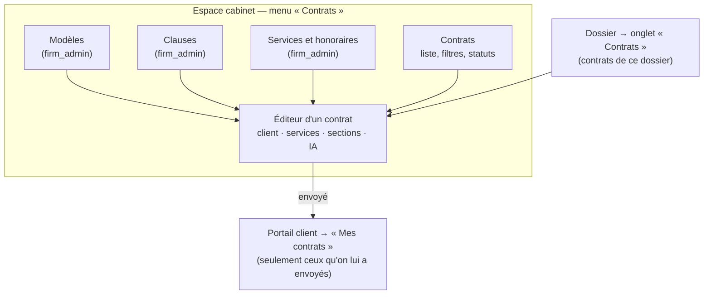
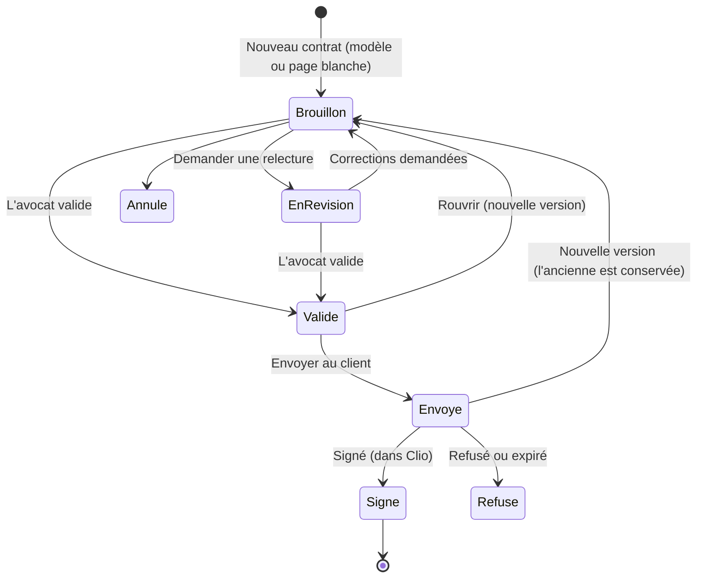

# Plan — Contrats : rédaction dans la plateforme, modèles, services, assistant IA, envoi et suivi

> Statut : **proposition v2, en attente de validation** (2026-10-18). Aucun code n'est écrit avant votre « oui ».
> v2 : ajout d'une vraie **zone de rédaction et de modification** dans la plateforme, de la fiche du client dans le contrat, d'un catalogue de **services et honoraires**, de l'IA par section et du **suivi des contrats envoyés**.
> Rattachement : phase 4 « Ressources et rédaction » et phase 6 « Assistant de rédaction (IA) » de `docs/plan-developpement.md`.

## 1. Ce que j'ai compris

1. Une section **Contrats** dans l'espace cabinet, où l'on **rédige et modifie** chaque contrat directement dans la plateforme.
2. Dans le contrat, on renseigne **le client** (nom, courriel, adresse, téléphone, langue) et **les services** (description, honoraires, taxes). Si le client existe déjà, tout se remplit seul.
3. On part d'un **modèle prêt et enregistré** (convention de mandat, convention d'honoraires, contrat de services…) ou d'une page blanche.
4. **OpenAI aide à rédiger** une section, à reformuler, à traduire, ou à créer un gabarit complet. L'avocat garde toujours la main.
5. On **voit tous les contrats** : brouillons, envoyés, signés, avec leur historique.
6. Les contrats finaux sont rangés **dans Clio et dans SharePoint** (décision du 2026-10-18), et la signature se fait **dans Clio** (option A).

## 2. Où se trouve la section dans la plateforme

| Où | Qui | Ce qu'on y fait |
|---|---|---|
| **Contrats** (nouveau menu) | personnel | Liste de tous les contrats auxquels on a accès : client, dossier, modèle, avocat, statut, dates. Filtres : statut, avocat, domaine, bureau, période. Bouton **« Nouveau contrat »**. |
| **Contrats → Modèles** | firm_admin (lecture : personnel) | Créer et modifier les modèles enregistrés, dans le même éditeur. Versions, domaine, langue. |
| **Contrats → Clauses** | firm_admin | Bibliothèque de clauses approuvées, FR et EN. |
| **Contrats → Services et honoraires** | firm_admin | Catalogue des services du cabinet : nom, description, forfait ou taux horaire, taxes par province. |
| **Dossier → onglet Contrats** | équipe du dossier | Les contrats de ce dossier, et « Nouveau contrat » pré-rempli avec le dossier. |
| **Portail client → Mes contrats** | client | Seulement les contrats **envoyés** : lecture, téléchargement PDF, statut (« à signer », « signé »). Jamais un brouillon. |

## 3. Le parcours d'un contrat

| Étape | Ce qui se passe |
|---|---|
| **Créer** | « Nouveau contrat » → choisir un **modèle** (filtré selon le domaine du dossier) ou une page blanche → choisir le **client** : client existant (fiche remplie seule) ou **nouveau client** (saisie : nom, courriel, adresse, téléphone, langue). Dossier lié : existant, ou aucun pour l'instant (cas d'une convention de mandat avant l'ouverture du dossier). |
| **Rédiger** | L'éditeur montre le contrat en **sections** (parties, objet, services, honoraires, durée, résiliation…). Chaque section se modifie directement : gras, listes, titres. Les **champs** (`Nom du client`, `Adresse`, `Total des honoraires`…) apparaissent comme des étiquettes qui se remplissent seules. Enregistrement automatique. |
| **Services** | Tableau des services : choisis dans le catalogue ou saisis à la main, quantité, forfait ou taux horaire, **taxes selon la province du client** (TVH au N.-B., en N.-É. et en Ontario ; TPS + TVQ au Québec), total calculé. Les montants sont exacts (jamais d'arrondi flottant). |
| **IA** | Sur chaque section : **Rédiger**, **Reformuler**, **Simplifier**, **Traduire FR ↔ EN**. Sur le contrat : **Créer un gabarit** à partir d'une description (« convention d'honoraires pour un permis de travail »), **Vérifier** avec la liste de contrôle du domaine. Le texte proposé s'affiche **à côté**, l'avocat l'accepte, le modifie ou le rejette. |
| **Relire** | Optionnel : demander la relecture d'un autre avocat, avec des commentaires par section. |
| **Valider** | L'avocat valide : la version est **figée** (personne ne peut la modifier). Un PDF et un Word sont produits. Dépôt automatique **dans Clio et SharePoint**. |
| **Envoyer** | Deux possibilités : (a) **dans le portail** : le client le voit dans « Mes contrats » et reçoit un courriel sans contenu, avec un lien. S'il n'a pas de compte, une invitation lui est envoyée ; (b) **pour signature dans Clio** : l'avocat lance la signature depuis Clio (option A), la plateforme lui ouvre le bon dossier Clio. |
| **Suivre** | Statut, date d'envoi, à qui, consulté par le client (oui/non, date), signé. Relance possible. Tout est journalisé. |
| **Modifier après envoi** | On ne modifie jamais un contrat envoyé : on crée une **nouvelle version**. L'ancienne reste consultable et marquée « remplacée ». |

## 4. Angles morts relevés, et ce que je propose

| # | Angle mort | Risque | Ce que je propose |
|---|---|---|---|
| 1 | **Les informations du client changent** après la signature | Le contrat signé afficherait la nouvelle adresse. | Le contrat garde **sa propre copie** des informations du client au moment de la validation. La fiche du client peut évoluer sans toucher aux contrats signés. |
| 2 | **Nouveau client sans compte ni dossier** (convention de mandat avant l'ouverture) | Données saisies en double, ou client créé par erreur. | Le contrat accepte un **client sans compte**. À la signature, un bouton propose d'**ouvrir le dossier** et d'**inviter le client** au portail, avec les informations déjà saisies. Les doublons sont détectés par courriel. |
| 3 | **Taxes et montants** | Mauvaise taxe selon la province, erreurs d'arrondi. | Taux de taxes **par province**, gérés par le firm_admin, avec date d'effet. Montants en décimal exact. Le taux utilisé est figé dans le contrat validé. |
| 4 | **Champ vide ou faux** | Un contrat avec un blanc part chez le client. | Validation **bloquée** tant qu'un champ obligatoire est vide. Les champs vides sont surlignés en rouge. |
| 5 | **Version du modèle ou de la clause** | Une ancienne clause réutilisée sans le savoir. | Modèles et clauses **versionnés**. Le contrat garde la version utilisée. Un message signale qu'une version plus récente existe. |
| 6 | **Brouillon vu par le client** | Fuite d'un texte non validé. | Le client ne voit **que** les contrats envoyés. Contrôle en base, avec tests automatiques. |
| 7 | **Modification d'un contrat envoyé** | Le client a signé un texte différent de celui conservé. | Contrat **figé** dès la validation. Toute modification crée une nouvelle version. Une empreinte du PDF est conservée. |
| 8 | **Deux modifications en même temps** | Deux avocats écrasent le travail de l'autre. | Verrou par contrat : « En cours de modification par Me X ». La deuxième personne lit seulement. |
| 9 | **IA : erreurs et inventions** | Une clause inventée, une loi citée à tort. | L'IA **propose seulement**. Le texte accepté porte la mention « rédigé avec l'IA, à réviser ». Validation humaine obligatoire. L'IA ne cite pas de jurisprudence. |
| 10 | **IA : données personnelles** (Loi 25 pour Montréal) | Noms et adresses de clients envoyés à OpenAI, hors du Canada. | **Simulateur** tant que le cabinet n'a pas décidé. Ensuite : les champs du client sont **remplacés par des étiquettes** avant l'envoi (OpenAI ne voit jamais le vrai nom ni l'adresse), conservation zéro, appels par le serveur seulement, plafond de coût, journal sans contenu. |
| 11 | **Texte collé depuis ailleurs** (courriel, site web) | Mise en forme cassée, ou contenu piégé. | Le collage est nettoyé : texte et mise en forme simple seulement. Rien n'est exécuté. |
| 12 | **Double dépôt Clio et SharePoint** | Deux copies divergentes. | Le même PDF final, avec la même empreinte, va dans les deux. Un échec est réessayé et signalé dans « À surveiller ». Dépôt Clio à vérifier sur le compte de test. SharePoint en simulateur jusqu'à notre séance Microsoft. |
| 13 | **Langue au Québec** (Charte de la langue française) | Contrat proposé d'abord en anglais à un client du Québec. | Question au cabinet, je ne tranche pas. En attendant : la langue du client par défaut, le français toujours disponible, et les versions FR et EN liées entre elles. |
| 14 | **Qui voit quels contrats** | Un employé voit les honoraires de tous les clients. | Même règle que les dossiers : l'**équipe du dossier** et le firm_admin. Un contrat sans dossier est visible de son auteur, des personnes qu'il désigne et du firm_admin. |
| 15 | **Téléphone et accessibilité** | Un éditeur inutilisable à 375 px. | Sur téléphone : **lecture**, suivi, envoi et relance. La rédaction se fait sur ordinateur, avec un message clair. Éditeur utilisable au clavier et au lecteur d'écran. |

## 5. Plan de travail (lots)

| Lot | Contenu | Accès externe | Base de données |
|---|---|---|---|
| **1. Section Contrats et éditeur** | Menu « Contrats », liste et filtres, « Nouveau contrat », fiche du client (existant ou nouveau), éditeur par sections avec champs, enregistrement automatique, verrou, versions, aperçu PDF. Onglet « Contrats » dans le dossier. | Aucun | Contrats, versions, sections, parties (RLS, audit) |
| **2. Modèles, clauses, services** | Modèles enregistrés créés dans l'éditeur (versions, domaine, langue), bibliothèque de clauses, catalogue des services et honoraires, taxes par province. 3 modèles de démonstration. Import d'un modèle Word existant : en option, plus tard. | Aucun | Modèles, clauses, services, taxes |
| **3. Valider, envoyer, suivre** | Relecture et commentaires, validation (version figée, PDF et Word, empreinte), envoi dans le portail (le client voit « Mes contrats »), suivi (envoyé, consulté, signé, relance), nouvelle version après envoi, passage au dossier et invitation du client à la signature. | Aucun | Envois, consultations |
| **4. Dépôt Clio et SharePoint, signature Clio** | Dépôt automatique du PDF final dans les deux, reprise sur échec, lien « Signer dans Clio ». | **Clio** : envoi de fichiers à vérifier sur le compte de test. **SharePoint** : simulateur, puis séance Microsoft. | État des dépôts |
| **5. Assistant IA (OpenAI)** | Rédiger, reformuler, simplifier, traduire une section ; créer un gabarit ; vérifier avec la liste de contrôle ; champs du client masqués avant l'envoi ; plafond de coût. **Simulateur d'abord.** | **OpenAI** : clé du cabinet et décisions (section 6) | Coût du mois, audit sans contenu |

Ordre : 1 → 2 → 3 → 4, puis 5. L'**emplacement de l'IA** (boutons dans l'éditeur, simulateur) est posé dès le lot 1, pour que vous voyiez l'ensemble tout de suite.

Nouvelles librairies probables, évaluées avec `/securite dependance` avant tout ajout :
- un éditeur de texte riche pour React (TipTap, basé sur ProseMirror, ou équivalent) ;
- la production de PDF et de Word côté serveur.

## 6. Décisions à prendre par le cabinet

1. ~~Où ranger les contrats générés ?~~ ✅ **Dans Clio ET dans SharePoint** (2026-10-18).
2. **Les vrais modèles** à créer en premier : convention de mandat, convention d'honoraires, autres ? Fournir le texte actuel, sans données de clients. Je pars de 3 modèles de démonstration.
3. **Services et honoraires** : la liste des services et des tarifs à mettre dans le catalogue. Exemples fictifs en attendant.
4. **Québec** : imposer la version française d'abord pour un client du bureau de Montréal ?
5. **Qui valide** un contrat : l'avocat responsable seulement, ou tout avocat de l'équipe ? Une relecture par un second avocat est-elle obligatoire pour certains modèles ?
6. **IA**, avant de brancher OpenAI :
   - accord pour masquer les données du client avant l'envoi (ma recommandation) ;
   - conservation zéro chez OpenAI ;
   - plafond de coût mensuel ;
   - évaluation Loi 25 pour les clients du Québec ;
   - clé OpenAI créée par le cabinet, transmise par un canal sécurisé, jamais dans le chat.

Aucune de ces décisions ne bloque les lots 1 à 3.

## 7. User stories (zone F — Contrats et rédaction)

### Lot 1 — Section Contrats et éditeur
**F1. En tant que membre du personnel, je veux une section « Contrats » qui liste tous mes contrats, afin de savoir où en est chacun.**
- [ ] Liste : client, dossier, modèle, avocat, statut, date de modification, date d'envoi.
- [ ] Filtres : statut, avocat, domaine, bureau, période ; recherche par client.
- [ ] Je ne vois que les contrats de mes dossiers (tous pour le firm_admin). Un test le prouve.

**F2. En tant que membre du personnel, je veux créer un contrat pour un client existant ou nouveau, afin de ne rien ressaisir.**
- [ ] Client existant : nom, courriel, adresse, téléphone et langue remplis seuls.
- [ ] Nouveau client : je saisis ces informations ; un courriel déjà connu est signalé (doublon).
- [ ] Le contrat peut être lié à un dossier, ou à aucun pour l'instant.

**F3. En tant que membre du personnel, je veux rédiger et modifier le contrat dans la plateforme, afin de ne pas dépendre de Word.**
- [ ] Le contrat est découpé en sections ; chacune se modifie (gras, listes, titres).
- [ ] Les champs s'affichent comme des étiquettes remplies ; un champ vide est surligné.
- [ ] Enregistrement automatique ; historique des versions ; aperçu PDF.
- [ ] Si quelqu'un d'autre modifie le même contrat, je le vois et je suis en lecture seule.

### Lot 2 — Modèles, clauses, services
**F4. En tant qu'Admin, je veux créer et maintenir des modèles de contrats, afin que l'équipe parte de textes approuvés.**
- [ ] Un modèle se crée dans le même éditeur, avec domaine, langue et sections.
- [ ] Chaque publication crée une version ; les contrats gardent la version utilisée.

**F5. En tant qu'Admin, je veux une bibliothèque de clauses bilingues, afin de composer un contrat avec des textes validés.**
- [ ] Dans l'éditeur, j'insère une clause depuis la bibliothèque, en FR ou en EN.

**F6. En tant qu'Admin, je veux un catalogue de services et d'honoraires avec les taxes par province, afin que les montants soient justes.**
- [ ] Service : nom FR et EN, description, forfait ou taux horaire, domaine.
- [ ] Taxes par province, avec date d'effet ; total calculé exactement.
- [ ] Le tableau des services d'un contrat validé ne change plus.

### Lot 3 — Valider, envoyer, suivre
**F7. En tant qu'avocat, je veux valider un contrat, afin d'en figer le texte avant l'envoi.**
- [ ] Validation bloquée si un champ obligatoire est vide.
- [ ] Une fois validé : version figée, PDF et Word produits, empreinte conservée.
- [ ] Relecture optionnelle par un autre avocat, avec commentaires par section.

**F8. En tant qu'avocat, je veux envoyer un contrat au client et suivre son statut, afin de savoir s'il l'a lu et signé.**
- [ ] Envoi dans le portail : le client le voit dans « Mes contrats » et reçoit un courriel sans contenu.
- [ ] Client sans compte : une invitation lui est envoyée.
- [ ] Suivi : envoyé (date, à qui), consulté (date), signé ; relance possible.
- [ ] Après l'envoi, toute modification crée une nouvelle version ; l'ancienne est marquée « remplacée ».

**F9. En tant que client, je veux voir les contrats que le cabinet m'a envoyés, afin de les lire et de les télécharger.**
- [ ] Je ne vois que les contrats envoyés, jamais un brouillon.
- [ ] Je télécharge le PDF ; mon ouverture est notée (le cabinet sait que je l'ai consulté).

**F10. En tant qu'avocat, je veux ouvrir le dossier et inviter le client à partir d'un contrat signé, afin d'enchaîner sans ressaisie.**
- [ ] « Ouvrir le dossier » reprend le client, le domaine et les services du contrat.

### Lot 4 — Dépôt et signature
**F11. En tant qu'avocat, je veux que le contrat validé soit rangé dans Clio et SharePoint, afin de ne pas le déposer à la main.**
- [ ] Le même PDF est déposé dans les deux ; l'état de chaque dépôt est visible.
- [ ] Un échec est réessayé automatiquement et signalé dans « À surveiller ».
- [ ] Un lien ouvre le dossier Clio pour lancer la signature.

### Lot 5 — Assistant IA (OpenAI)
**F12. En tant qu'avocat, je veux que l'IA m'aide à rédiger une section, afin de gagner du temps.**
- [ ] Sur une section : Rédiger, Reformuler, Simplifier, Traduire FR ↔ EN.
- [ ] La proposition s'affiche à côté ; je l'accepte, la modifie ou la rejette.
- [ ] Le texte accepté est marqué « rédigé avec l'IA, à réviser ».

**F13. En tant qu'avocat, je veux que l'IA crée un gabarit de contrat à partir d'une description, afin de démarrer un nouveau type de contrat.**
- [ ] Le gabarit est un brouillon, jamais un modèle publié sans validation du firm_admin.

**F14. En tant qu'Admin, je veux encadrer l'IA (données masquées, plafond de coût), afin de protéger les clients et la facture.**
- [ ] Les informations du client sont remplacées par des étiquettes avant l'envoi à OpenAI.
- [ ] Au-delà du plafond mensuel, l'assistant se désactive jusqu'au mois suivant, avec un message clair.
- [ ] Le journal indique chaque utilisation, jamais son contenu.

## 8. Ce que je vous demande

- **« oui »** : je publie les stories F1 à F14 en issues GitHub et je commence le **lot 1** (section Contrats et éditeur, avec l'emplacement de l'IA en simulateur).
- Quand vous pouvez : les décisions 2 à 6 de la section 6.
