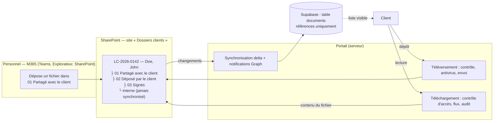

# Intégration SharePoint / Microsoft Graph — gestion des fichiers clients (v2)

> v2 du 2026-10-01. Remplace `archive/sharepoint-integration-v1.md`.
> **Décision du cabinet (ADR 0004) : SharePoint Online est le dépôt officiel des fichiers clients.** Le portail n'en conserve que des références.
> Mentions **[À VÉRIFIER]** : capacité de Microsoft Graph connue mais à reconfirmer dans la documentation Microsoft et sur le tenant réel, avant d'écrire le code de la Phase 3.

## 1. Principe

- **Le personnel continue de travailler dans SharePoint/Teams.** Pour partager un fichier avec le client, il le place dans `01 Partagé avec le client`. Le fichier apparaît dans le portail après la synchronisation suivante.
- **Les fichiers déposés par le client** arrivent dans `02 Déposé par le client`, après antivirus. Le cabinet les voit immédiatement dans SharePoint.
- **Les documents signés** (retour du fournisseur de signature) sont déposés dans `03 Signés`.
- **Tout autre dossier** (`Interne`, notes, brouillons) **n'est jamais lu par le portail**. La visibilité découle de l'emplacement : aucune case « visible client » ne peut être oubliée.

## 2. Organisation SharePoint

| Élément | Choix proposé | Raison |
|---|---|---|
| Site | **Site dédié** « Lex Canada — Dossiers clients » (site d'équipe sans groupe M365, ou site de communication) | Permet de limiter l'application à **ce seul site** (`Sites.Selected`) |
| Bibliothèque | Une bibliothèque « Dossiers » | Une seule synchronisation delta à suivre |
| Dossier par matter | `{display_number} — {Nom}, {Prénom} — {titre court}` (ex. `LC-2026-0142 — Doe, John — Résidence permanente`) | Lisible par le personnel, trié par numéro |
| Sous-dossiers | `01 Partagé avec le client`, `02 Déposé par le client`, `03 Signés`, `Interne` | Visibilité par emplacement |
| Colonnes de métadonnées | `ClioMatterId`, `PortalMatterId`, `PortalDocumentId`, `DeposePar` (client/cabinet), `Categorie` | Rapprochement sans dépendre du nom de dossier |
| Création | **Par le portail**, au premier octroi d'accès à un dossier (idempotent) → `private.matter_storage_folders` | Pas de création manuelle, nommage garanti |
| Versions, rétention, conservation légale | **Natives SharePoint / Microsoft Purview** | Le portail n'affiche que la dernière version |

**État confirmé par le cabinet (2026-10-01) : les dossiers clients existent déjà dans SharePoint et dans Clio.** Conséquences :
- **On s'adapte à l'existant** : pas de nouveau site si l'arborescence actuelle convient. Le portail **rattache** chaque dossier Clio à son dossier SharePoint existant (`private.matter_storage_folders`, rempli par un firm_admin depuis `/admin/matters` ou par correspondance automatique sur le numéro de dossier), et **crée seulement les 3 sous-dossiers client** à l'intérieur s'ils n'existent pas.
- `Sites.Selected` doit couvrir le ou les sites existants. S'il y a un site par client, la liste des sites autorisés s'allonge à chaque nouveau client : à évaluer quand l'arborescence sera connue.
- **Répartition SharePoint / Clio à clarifier** (open-questions, critique) : le portail ne doit lire qu'**une** référence pour les fichiers partagés avec le client. Par défaut (ADR 0004) : SharePoint. **[À VÉRIFIER]** si une intégration Clio ↔ SharePoint ou Power Automate synchronise déjà les deux.

## 3. Correspondance avec la base

| Sous-dossier SharePoint | `documents.folder` | Visible par le client |
|---|---|---|
| `01 Partagé avec le client` | `shared` | Oui |
| `02 Déposé par le client` | `client_upload` | Oui (ses dépôts et ceux des autres contacts du dossier) |
| `03 Signés` | `signed` | Oui |
| Tout autre | `internal` (en pratique, jamais synchronisé) | **Non**, bloqué par la RLS en plus |

Stocké dans `public.documents` : `external_drive_id`, `external_item_id`, `external_etag`, nom, type MIME, taille, `sha256` (pour les dépôts client), statut, `scan_status`.
Stocké uniquement dans `private` : identifiants de site et de dossier, **URL SharePoint** (jamais envoyée au client), état delta, abonnements.

## 4. Authentification de l'application auprès de Microsoft Graph

| Élément | Choix |
|---|---|
| App Registration | **Distincte** de celle de la connexion du personnel : « Lex Canada Portal — Documents (Graph) », single-tenant |
| Type d'accès | **Application (app-only)**. Les clients n'ont pas d'identité Microsoft, donc l'isolation entre clients est portée par le portail (RLS + `AccessControlService`) |
| Permission | `Sites.Selected` (application), puis **attribution explicite du rôle `write` sur le seul site « Dossiers clients »** par un administrateur (Graph `POST /sites/{site-id}/permissions`). Sans cette attribution, l'application n'a accès à rien |
| Option plus fine | Permissions « selected » au niveau liste ou fichier (`Lists.SelectedOperations.Selected`, etc.) **[À VÉRIFIER]** disponibilité sur le tenant |
| Identifiant | **Certificat** plutôt que secret client, conservé dans le coffre-fort (Azure Key Vault recommandé) ; rotation planifiée |
| Interdit | `Sites.ReadWrite.All`, `Files.ReadWrite.All` : accès à tout le tenant |

## 5. Flux

### 5.1 Création du dossier (au premier octroi d'accès)
1. `AccessControlService.grantAccess()`, puis `DocumentStore.ensureMatterFolder(matter)`.
2. Si `matter_storage_folders` n'a pas de ligne : création du dossier et des 3 sous-dossiers client + `Interne` (Graph : `POST /drives/{drive-id}/items/{parent-id}/children`, `conflictBehavior: fail`), écriture des métadonnées, puis enregistrement des identifiants.
3. Journal : `storage.folder_created`.

### 5.2 Synchronisation SharePoint → portail
- **Requête delta** sur la bibliothèque (`GET /drives/{drive-id}/root/delta`, puis le `deltaLink` mémorisé dans `private.graph_delta_state`). On ne retient que les éléments dont le parent est un des sous-dossiers client connus. Les autres sont ignorés.
- **Notifications de changement** (webhook Graph) sur la racine de la bibliothèque. Elles servent seulement de **déclencheur** de la requête delta (elles ne contiennent pas le détail). **[À VÉRIFIER]** : sur SharePoint/OneDrive Entreprise, les abonnements `driveItem` ne sont acceptés qu'à la racine du lecteur.
- **Validation** de chaque notification : `clientState` comparé au hachage stocké (`private.graph_subscriptions`) + réponse à la requête de validation à la création. Les abonnements **expirent** : une tâche planifiée les renouvelle avant `expires_at`.
- **Filet de sécurité** : requête delta planifiée toutes les 15 min, même sans notification.
- Création, renommage, déplacement, suppression → upsert ou suppression logique dans `documents`. Un fichier sorti de `01 Partagé` disparaît du portail.
- Nouveau fichier dans `01 Partagé` ou `03 Signés` → notification `new_document` au client (e-mail **sans** le nom du fichier).

### 5.3 Dépôt par le client
1. Contrôle serveur : `assertMatterAccess(read_write)`, limitation de débit, liste blanche d'extensions **et** type réel (magic bytes), taille maximale (à fixer).
2. **Antivirus**, deux options à arbitrer (open-questions) :

| | Option A — antivirus du portail avant SharePoint | Option B — Microsoft Defender dans SharePoint |
|---|---|---|
| Fonctionnement | Fichier en quarantaine (bucket privé Supabase), analyse, puis envoi | Envoi dans un dossier de quarantaine SharePoint ; Defender pour Office 365 (« Safe Attachments for SharePoint ») analyse ; le portail lit l'indicateur `malware` de l'élément **[À VÉRIFIER]** |
| Avantages | Résultat certain avant tout dépôt officiel | Le fichier ne quitte jamais Microsoft 365 (résidence simplifiée) ; aucun fournisseur de plus |
| Inconvénients | Un sous-traitant de plus ; transit hors M365 | Analyse asynchrone ; dépend de la licence (Business Premium inclut normalement Defender pour Office 365 P1 **[À VÉRIFIER]**) |

3. Envoi dans `02 Déposé par le client` : envoi simple pour les petits fichiers, **session d'envoi** (`createUploadSession`) pour les gros. `conflictBehavior: rename`.
4. Écriture des métadonnées (`PortalDocumentId`, `DeposePar = client`), ligne `documents` (`folder = client_upload`, `sha256`), journal `document.uploaded`, notification au responsable du dossier.

### 5.4 Téléchargement et aperçu par le client
1. `assertMatterAccess(read)`. Vérification que le document est visible (même règle que la RLS).
2. **Le serveur transmet le contenu en flux** (`GET /drives/{drive-id}/items/{item-id}/content`) avec `Content-Disposition: attachment`. On n'envoie **jamais** au client l'URL SharePoint, ni l'URL pré-authentifiée `@microsoft.graph.downloadUrl` (transférable tant qu'elle est valide).
3. **Aperçu** (icône « œil » de la maquette) : PDF et images affichés en ligne via le même flux (`inline`) ; documents Office convertis en PDF par Graph (`/content?format=pdf`) **[À VÉRIFIER]** pour les formats concernés.
4. Journal : `document.downloaded` / `document.previewed`.

### 5.5 Signature électronique
La signature se fait dans Clio (option A, 2026-10-15 ; ADR 0045) : le PDF validé est déposé dans le dossier Clio et l'avocat lance la signature depuis Clio. Le rangement du PDF signé dans `03 Signés` reste à définir avec le branchement Microsoft.

## 6. Robustesse

| Sujet | Règle |
|---|---|
| Limitation Graph (HTTP 429 / 503) | Respect de `Retry-After`, backoff exponentiel, jobs dans `private.sync_jobs` |
| Validation | Toute réponse Graph est validée par Zod (`server/providers/sharepoint/schemas.ts`) |
| Renommage d'un dossier dans SharePoint par le personnel | Aucun impact : on suit les identifiants (`item_id`), pas les noms |
| Fichier supprimé dans SharePoint | Suppression logique (`deleted_at`) dans le portail ; SharePoint garde sa corbeille et sa rétention |
| Erreur de synchronisation | `FreshnessIndicator` dans le portail ; alerte dans `/admin/sync` |

## 7. Résidence des données

- Région de données du tenant M365 `LEXCANADALAW.COM` : vérifier dans le centre d'administration Microsoft 365 (Paramètres → Profil de l'organisation → **Emplacement des données**). Elle doit indiquer le Canada.
- Avec l'option B (antivirus Defender), le contenu des fichiers ne quitte jamais M365. Seules les métadonnées (nom, taille, dates) sont en base Supabase `ca-central-1`.

## 8. Ce dont on a besoin du cabinet (Phase 3)

1. Accord sur l'organisation (site dédié, sous-dossiers) **ou** description de l'organisation existante.
2. Un administrateur M365 pour : créer l'App Registration « Documents (Graph) » ; accorder `Sites.Selected` ; attribuer le rôle `write` au site ; créer le certificat.
3. Choix de l'antivirus (option A ou B) et vérification de la licence Defender pour Office 365.
4. Taille maximale et formats acceptés pour les dépôts client.
5. Politique de rétention applicable (Purview) aux dossiers clients.
