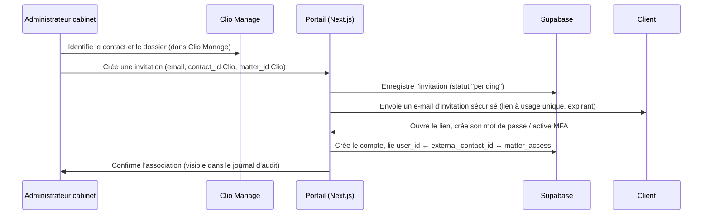
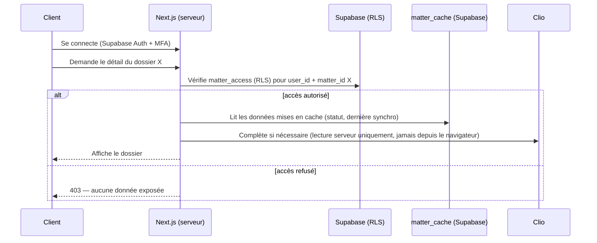
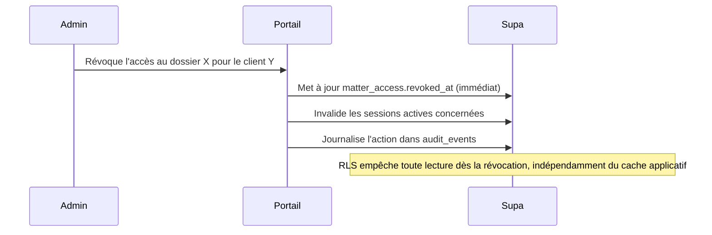
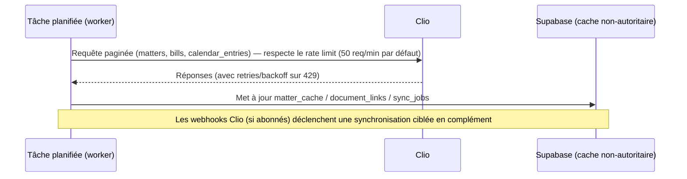
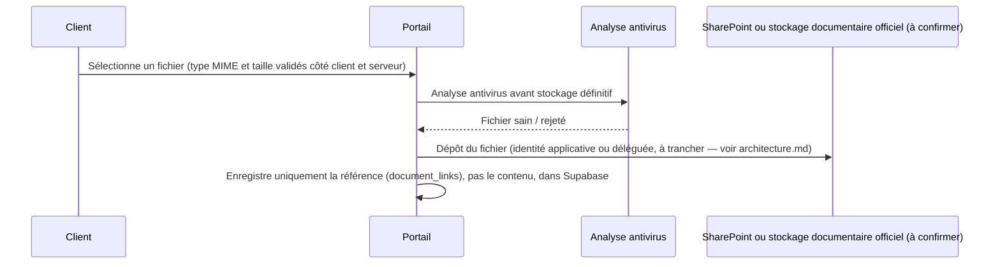

# Flux utilisateurs — Portail Client Lex Canada

## 1. Invitation et activation d'un client

**Hypothèse d'architecture :** l'association ne doit jamais reposer uniquement sur la correspondance d'adresse e-mail ; elle doit être initiée manuellement par un administrateur du cabinet à partir d'un contact Clio identifié, avec confirmation explicite par le client lors de l'activation (double facteur : lien à usage unique + vérification e-mail).

## 2. Authentification et accès à un dossier

## 3. Révocation d'accès

## 4. Synchronisation périodique (dossiers, factures, calendrier)

## 5. Téléversement d'un document par un client

## Sources et niveau de confirmation

- Flux dérivés du cahier des charges (règles de RLS, révocation immédiate, non-copie du contenu documentaire).
- Rate limit (50 req/min, entêtes `X-RateLimit-*`, `Retry-After`) : confirmé par la documentation Clio.
- Pagination à 200 résultats par page : confirmé par la documentation Clio.
- Webhooks Clio Manage (signés par `shared_secret`, par modèle de ressource) : confirmés par la documentation Clio.
- Modèle d'identité SharePoint (applicative vs déléguée) : hypothèse d'architecture, à trancher en Phase 0 avec le cabinet — voir `architecture-evaluation.md` §12.
